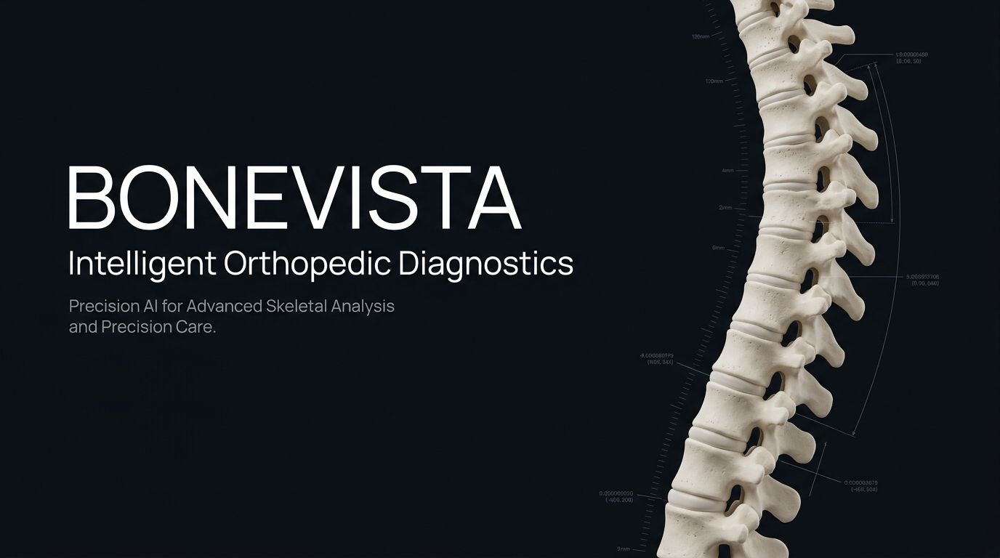
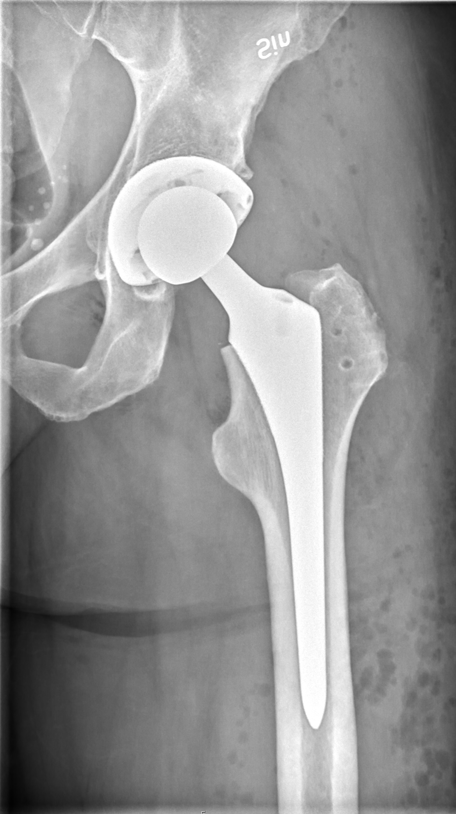
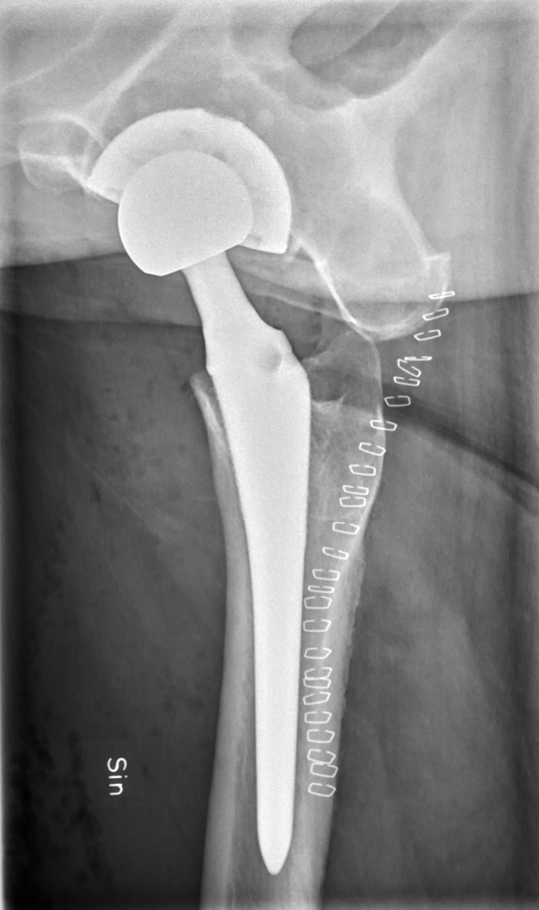
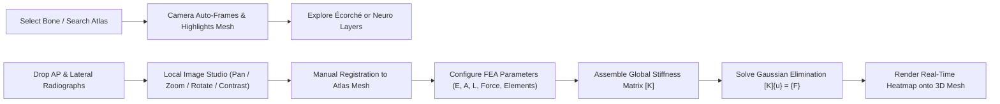

# <div align="center">🦴 BoneVista</div>

<div align="center">

**Next-Generation 3D Biomechanical & Anatomical Visualization Engine**  
*Segmented 3D Skeletal Atlas · Dual-Layer Muscle Écorché · Neuro & Brain Explorer · 1D Axial FEA Simulation · Bi-Planar Radiograph Studio*

[](https://react.dev/)
[](https://threejs.org/)
[](https://vitejs.dev/)
[](https://www.typescriptlang.org/)
[](https://www.python.org/)
[](https://fastapi.tiangolo.com/)
[](https://playwright.dev/)
[](LICENSES.md)

</div>

---

<p align="center">
  
</p>

<p align="center">
  <a href="#-interactive-showcase"><b>Explore Showcase</b></a> •
  <a href="#-key-features"><b>Key Features</b></a> •
  <a href="#-system-architecture"><b>Architecture</b></a> •
  <a href="#-mathematical-formulation"><b>FEA Formulation</b></a> •
  <a href="#-x-ray-reconstruction-microservice"><b>FastAPI Microservice</b></a> •
  <a href="#-quick-start"><b>Quick Start</b></a> •
  <a href="#-clinical-disclaimer"><b>Disclaimer</b></a>
</p>

---

## 🌟 Overview

**BoneVista** is an interactive, browser-based anatomical learning and biomechanical exploration workspace. Built from the ground up with **React 19**, **Three.js**, and **React Three Fiber**, it merges segmented 3D skeletal geometry, deep/superficial muscle Écorché layers, cerebral and peripheral neuroanatomy, an educational 1D axial Finite Element Analysis (FEA) stress engine, and a bi-planar (AP & Lateral) digital radiograph suite.

All image processing and rendering are executed **locally inside the browser** or through an optional, privacy-first local FastAPI microservice—safeguarding data privacy with zero external telemetry.

> [!IMPORTANT]
> **Educational & Research Notice:** BoneVista is an educational prototype and software demonstration platform. It is **not** a clinical diagnostic system, medical device, patient-record repository, or surgical treatment planner.

---

## 🎨 Interactive Showcase

<table align="center" width="100%">
  <tr>
    <td width="33%" align="center" valign="top">
      
      <br />
      <b>💀 3D Skeletal Atlas</b>
      <p>335+ segmented reference bones with 6-DOF camera controls, Draco decompression, and single-click structure isolation.</p>
    </td>
    <td width="33%" align="center" valign="top">
      
      <br />
      <b>🥩 Muscle Explorer (Écorché)</b>
      <p>Superficial & deep muscular layers, paired skeleton-plus-muscles combined view, and synchronized camera focus.</p>
    </td>
    <td width="33%" align="center" valign="top">
      
      <br />
      <b>🧠 Neuro & Brain Atlas</b>
      <p>437 named cerebral structures & 255 peripheral nerves catalogued into 44 functional pathways.</p>
    </td>
  </tr>
  <tr>
    <td width="33%" align="center" valign="top">
      
      <br />
      <b>🦴 Spine Explorer</b>
      <p>Regionally filtered vertebral column: Cervical (C1–C7), Thoracic (T1–T12), Lumbar (L1–L5), Sacrum & Coccyx.</p>
    </td>
    <td width="33%" align="center" valign="top">
      
      <br />
      <b>🔬 1D Axial FEA Simulation</b>
      <p>Direct stiffness solver with live matrix assembly and real-time 0–10 MPa heatmapped mesh overlays.</p>
    </td>
    <td width="33%" align="center" valign="top">
      
      <br />
      <b>🩻 Bi-Planar Radiograph Studio</b>
      <p>Orthogonal AP/Lateral viewing studio with 800% zoom, image enhancement, and FastAPI microservice hook.</p>
    </td>
  </tr>
</table>

---

## ⚡ Key Features

### 1. 💀 High-Fidelity 3D Skeletal Atlas
- **335+ Segmented Anatomical Meshes:** Loaded from Draco-compressed `skeletal_male.glb` with an authoritative hierarchical manifest (`manifest.json`).
- **6 Anatomical Perspectives:** Instant one-click camera orientation presets:
  - `Ant` (Anterior / Front)
  - `Post` (Posterior / Back)
  - `Lat L` & `Lat R` (Left and Right Lateral)
  - `Sup` & `Inf` (Superior / Top and Inferior / Bottom)
- **Interactive Inspection:** Orbit, zoom, pan, select, deselect, search by English or Latin taxonomy, and toggle structure isolation.
- **Export Pipeline:** Export the current active 3D reference scene directly as **glTF/GLB**, **Wavefront OBJ**, or generate a formatted **PDF Summary Report**.

### 2. 🥩 Muscle Explorer (Écorché)
- **Dedicated Écorché Asset:** Bundles a 14 MB high-resolution Écorché model (`ecorche.glb`) derived from BodyParts3D/DBCLS and Z-Anatomy.
- **Dynamic Layer Presets:**
  - `Bones`: Returns to the original BoneVista segmented skeletal atlas.
  - `Superficial`: Isolates superficial muscle tissue.
  - `Deep`: Exposes deep muscle layers.
  - `Combined`: Synchronized Écorché bone-tissue and muscular hierarchy.
- **Unified Selection State:** Meshes share selection, isolation, and global anatomy search across workspace components.

### 3. 🧠 Neuro & Brain Explorer
- **Detailed Brain Atlas:** 437 individually catalogued cerebral structures (`brain.glb`) from the Brain Project.
- **Whole Nervous System:** Complete full-body peripheral nerve network (`nerves.glb`) with 255 named meshes grouped into 44 functional catalogues.
- **Cranial Nerve Isolation:** Frame the brain with cranial nerves toggled on/off to prevent visual occlusion.
- **Extensible Architecture:** Pre-configured hook for the microscopic Neuron Lab.

### 4. 🦴 Vertebral Spine Explorer
- **Vertebra-by-Vertebra Segmentation:** Inspect and isolate each vertebra across anatomical spinal curves:
  - **Cervical:** C1 (Atlas) through C7 (Vertebra Prominens)
  - **Thoracic:** T1 through T12
  - **Lumbar:** L1 through L5
  - **Sacral & Coccygeal:** Sacrum and Coccyx
- **Bilateral Synchronization:** Selecting any vertebra highlights the matching mesh and auto-focuses the camera in the 3D viewport.

### 5. 🔬 Educational 1D Axial FEA Stress Solver
- **Direct Stiffness Method:** Assembles 2-node linear axial bar finite elements into a global stiffness matrix $[K]$.
- **Configurable Parameters:**
  - Tensile / Compressive Axial Force $F$ ($\text{N}$)
  - Cross-sectional Area $A$ ($\text{mm}^2$)
  - Bone Shaft Length $L$ ($\text{mm}$)
  - Young's Elastic Modulus $E$ ($\text{GPa}$)
  - Discretization Elements $N$ ($1 \le N \le 100$)
- **Real-Time Heatmap Mapping:** Solves using Gaussian elimination and renders a scalar stress color overlay across the selected atlas bone on a normalized 0–10 MPa scale.

### 6. 🩻 Bi-Planar Radiograph Studio
- **Dual-Slot Orthogonal Viewer:** Dedicated slots for Anteroposterior (AP) and Lateral radiographic projections.
- **Real-Time Pixel Adjustment:** 10%–800% dynamic zoom, 90° stepped rotation, translation pan, and real-time brightness (25%–200%) & contrast (25%–250%) controls.
- **Bundled Teaching Dataset:** Includes openly licensed clinical hip arthroplasty AP & Lateral radiographs for instant testing:

<table align="center">
  <tr>
    <td align="center">
      <br />
      <sub><b>Anteroposterior (AP) Projection</b></sub>
    </td>
    <td align="center">
      <br />
      <sub><b>Lateral Projection</b></sub>
    </td>
  </tr>
</table>

- **Atlas Manual Registration:** Associate uploaded radiographs with any reference bone to carry into stress mapping.

---

## 📐 System Architecture

BoneVista coordinates a browser-based single-page application with static Draco-encoded glTF assets and a decoupled Python FastAPI microservice.

```mermaid
flowchart TD
    subgraph Client["Browser Client (React 19 + TypeScript + Vite)"]
        UI["Landing & Workspace Shell"]
        subgraph Store["State Management (Zustand)"]
            AppState["Selection, Theme & Layout State"]
            AtlasCache["Manifests & Anatomy Metadata"]
            XrayState["In-Memory Object URLs & Canvas Controls"]
        end
        subgraph Canvas3D["WebGL 3D Engine (Three.js & React Three Fiber)"]
            Draco["Draco Compressed Mesh Loader"]
            MeshCache["335+ Bone Meshes"]
            Ecorche["Écorché Muscular Layers"]
            NeuroScene["Brain & Peripheral Nerves"]
            Shader["Scalar Stress Heatmap Shader (0-10 MPa)"]
        end
        subgraph Solvers["Biomechanical & Export Engines"]
            FEA["1D Axial Bar FEA Direct Stiffness Solver"]
            Exporters["GLB, OBJ & PDF Exporters"]
        end
    end

    subgraph Service["Local AI Microservice (FastAPI + Python 3.10)"]
        API["FastAPI App (127.0.0.1:8000)"]
        Validator["Magic-Bytes & 25MB Upload Validator"]
        Pipeline["Reconstruction Pipeline Adapter"]
    end

    UI --> Store
    Store --> Canvas3D
    Store --> Solvers
    FEA --> Shader
    UI -.->|HTTP / REST (Optional)| API
    API --> Validator
    Validator --> Pipeline
```

### Biomechanical & Analysis Workflow



---

## 🔬 Mathematical Formulation

BoneVista incorporates an educational, linear-elastic 1D axial bar finite element solver to demonstrate direct stiffness matrix assembly and structural mechanics on biological tissues.

### 1. Element Stiffness Matrix
For an axial bar element $e$ of length $L_e = \frac{L}{N}$, cross-sectional area $A$, and elastic modulus $E$:

$$k_e = \frac{E A}{L_e} \begin{bmatrix} 1 & -1 \\ -1 & 1 \end{bmatrix}$$

### 2. Global System Assembly & Boundary Conditions
Elements are assembled into the global stiffness matrix $[K] \in \mathbb{R}^{(N+1) \times (N+1)}$:

$$[K] \{u\} = \{F\}$$

Fixed-end Dirichlet boundary conditions are applied at node 0 ($u_0 = 0$), and a tensile/compressive load $F$ is applied at node $N$:

$$\begin{bmatrix}
K_{11} & K_{12} & \dots & 0 \\
K_{21} & K_{22} & \dots & 0 \\
\vdots & \vdots & \ddots & \vdots \\
0 & 0 & \dots & K_{NN}
\end{bmatrix}
\begin{Bmatrix} u_1 \\ u_2 \\ \vdots \\ u_N \end{Bmatrix}
=
\begin{Bmatrix} 0 \\ 0 \\ \vdots \\ F \end{Bmatrix}$$

### 3. Axial Stress & Strain Calculation
Displacements $\{u\}$ are resolved via Gaussian elimination with back-substitution:

$$\varepsilon_e = \frac{u_{i+1} - u_i}{L_e}, \quad \sigma_e = E \cdot \varepsilon_e = \frac{F}{A}$$

### 4. Color Scalar Mapping
The calculated absolute axial stress $|\sigma|$ is normalized against a calibrated scale ($0 \text{ to } 10\text{ MPa}$) and mapped onto the 3D mesh:

$$\text{Intensity} = \text{clamp}\left( \frac{|\sigma|}{10\text{ MPa}}, 0, 1 \right) \quad \longrightarrow \quad \text{Color}(\text{Blue} \to \text{Cyan} \to \text{Yellow} \to \text{Red})$$

---

## ⚡ X-Ray Reconstruction Microservice

BoneVista includes an isolated **FastAPI** backend (`xray-reconstruction-service/`) implementing standard bi-planar X-ray to 3D reconstruction endpoints.

### API Specification & Endpoints

| Method | Endpoint | Description |
|---|---|---|
| `GET` | `/api/v1/health` | Returns service status and health payload |
| `GET` | `/api/v1/reconstruction/capabilities` | Truthfully reports AI inference availability and supported anatomies |
| `POST` | `/api/v1/reconstruction/jobs` | Submits bi-planar AP & Lateral radiographs for 3D reconstruction |
| `GET` | `/api/v1/reconstruction/jobs/{job_id}` | Polls reconstruction job status (`queued`, `processing`, `succeeded`, `failed`) |
| `GET` | `/api/v1/reconstruction/jobs/{job_id}/model.glb` | Downloads generated reconstructed 3D glTF/GLB model |

> [!NOTE]
> **Truthful Capability Reporting:** By default, `GET /api/v1/reconstruction/capabilities` returns `available: false` until a verified model checkpoint is configured. It does not fabricate patient meshes from generalized atlas data.

---

## ⌨️ Viewport & Navigation Controls

| Input | Action |
|---|---|
| <kbd>Left Click + Drag</kbd> | Orbit / Rotate 3D camera around reference center |
| <kbd>Right Click + Drag</kbd> or <kbd>Shift + Drag</kbd> | Pan 3D camera laterally / vertically |
| <kbd>Mouse Wheel</kbd> / <kbd>Pinch</kbd> | Smooth Zoom in and out (10% to 800% in 2D / continuous in 3D) |
| <kbd>Left Click</kbd> on Mesh | Select structure, trigger camera re-frame, and display metadata |
| <kbd>Left Click</kbd> on Background | Deselect current structure |
| <kbd>Ant</kbd> / <kbd>Post</kbd> / <kbd>Lat</kbd> / <kbd>Sup</kbd> / <kbd>Inf</kbd> | Snap camera to standard anatomical orientations |
| <kbd>Auto Rotate</kbd> | Toggle smooth 360° inspection rotation |
| <kbd>Isolate</kbd> | Hide non-selected structures for focused spatial inspection |
| <kbd>Esc</kbd> | Exit fullscreen maximized workspace |

---

## 🚀 Quick Start

### Prerequisites
- **Node.js** (v18.0+ or v20+) and **npm**
- Modern desktop web browser supporting **WebGL 2.0**
- *(Optional for microservice)* **Python 3.10+**

### 1. Launch Frontend Workspace
```bash
# Clone the repository
git clone https://github.com/spixcy/BoneVista.git
cd BoneVista

# Install dependencies
npm install

# Start development server
npm run dev
```
Open the local URL (typically `http://localhost:5173`). Click **Launch App** or scroll down to enter the embedded interactive workspace.

To create a production build:
```bash
npm run build
npm run preview
```

### 2. Launch Local FastAPI Microservice *(Optional)*
```powershell
cd xray-reconstruction-service

# Create and activate virtual environment
python -m venv .venv
.\.venv\Scripts\Activate.ps1

# Install requirements
pip install -r requirements-dev.txt

# Run pytest verification suite
pytest tests/ -v

# Start local service
python run.py
```
Service runs locally at `http://127.0.0.1:8000`.

### 3. Automated End-to-End Testing
```bash
# Run Playwright E2E test suite
npm run test:e2e
```

---

## 🔒 Data Handling & Privacy

- **Local-First Architecture:** Image uploads (AP and Lateral projections) are handled strictly in browser memory using ephemeral `blob:` object URLs.
- **Zero Cloud Leakage:** Radiographs are **never** forwarded to third-party servers, cloud analytics, or external AI platforms.
- **Storage Boundaries:** Theme preferences (`bonevista-theme`) are saved in the client's local `localStorage`.
- **Stateless Exports:** GLB, OBJ, and PDF exports are compiled in client memory and downloaded straight to your local drive.

---

## ⚠️ Clinical Disclaimer

> [!CAUTION]
> **NOT A MEDICAL DEVICE.** BoneVista is developed exclusively for educational demonstration, biomechanical software exploration, and computer graphics research.
>
> - BoneVista does **not** interpret, segment, or diagnose pathology from radiographs or CT scans.
> - Uploading a radiograph does **not** create a patient-specific anatomical bone mesh.
> - The 1D FEA solver is an idealized mathematical bar calculation; it does **not** simulate patient-specific geometry, implant micro-motion, bone fracture risk, or stress tensor fields.
> - Never rely on BoneVista for medical decision-making, diagnosis, surgical planning, or clinical evaluation. Always consult qualified healthcare professionals.

---

## 📜 Attributions & Licenses

BoneVista bundles high-quality, openly licensed anatomical assets with full provenance:

| Dataset / Asset | Source / Author | License | Description |
|---|---|---|---|
| **Skeletal Reference Atlas** | [Z-Anatomy](https://www.z-anatomy.com/) / [BodyParts3D](https://dbarchive.biosciencedbc.jp/en/bodyparts3d/) | [CC BY-SA 4.0](https://creativecommons.org/licenses/by-sa/4.0/) | 335+ segmented bone meshes & anatomical hierarchy |
| **Muscle Atlas (Écorché)** | [Charleeh / ecorche](https://github.com/Charleeh/ecorche) | [CC BY-SA 4.0](https://creativecommons.org/licenses/by-sa/4.0/) | High-resolution superficial and deep muscle layers |
| **Brain Atlas** | [Brain Project](https://sketchfab.com/3d-models/brain-project) | [CC BY-SA 4.0](https://creativecommons.org/licenses/by-sa/4.0/) | 437 named cerebral structures & cranial nerves |
| **Peripheral Nerves** | [3D Human Body Anatomy](https://sketchfab.com/3d-models/human-anatomy) | [CC BY-SA 4.0](https://creativecommons.org/licenses/by-sa/4.0/) | Full-body nerve tree with 255 mesh elements |
| **Hip Arthroplasty X-Rays** | Open Teaching Dataset | Open Access | Orthogonal AP & Lateral verification images |
| **BoneVista Codebase** | BoneVista Contributors | [MIT License](LICENSES.md) | Application source code & UI components |

Detailed notices, source commits, and copyleft terms are preserved in [`LICENSES.md`](LICENSES.md), [`THIRD-PARTY-NOTICES.md`](THIRD-PARTY-NOTICES.md), and [`public/neuro/NOTICE.md`](public/neuro/NOTICE.md).

---

<div align="center">

Crafted with 🦴 for anatomy learners, bioengineers, and computer vision researchers.  
⭐ **Star BoneVista on GitHub if you found it useful!**

</div>
