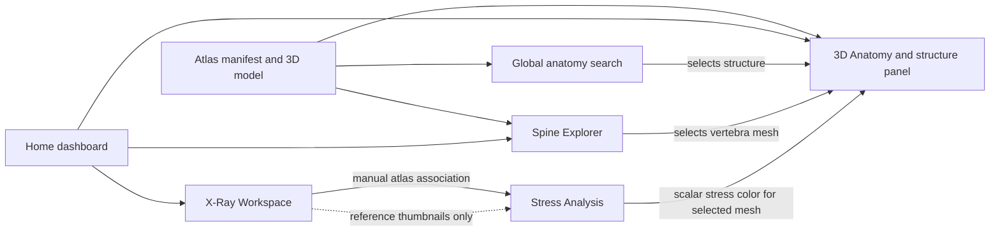

# BoneVista

BoneVista is a browser-based anatomy learning and exploration workspace. It combines an interactive segmented reference skeleton, a spine browser, a local radiograph viewer, and a small educational 1D axial finite-element example. It is a prototype for learning and software demonstration; it is not a clinical imaging, diagnostic, treatment-planning, or patient-record system.

## Contents

- [What BoneVista does](#what-bonevista-does)
- [Start the app](#start-the-app)
- [First-time walkthrough](#first-time-walkthrough)
- [How the features connect](#how-the-features-connect)
- [Landing page controls](#landing-page-controls)
- [Workspace navigation](#workspace-navigation)
- [Home page](#home-page)
- [3D Anatomy viewer](#3d-anatomy-viewer)
- [Atlas Structures panel](#atlas-structures-panel)
- [Spine Explorer](#spine-explorer)
- [X-Ray Workspace](#x-ray-workspace)
- [Stress Analysis](#stress-analysis)
- [Studies and Settings](#studies-and-settings)
- [Data handling and privacy](#data-handling-and-privacy)
- [Limits and things BoneVista does not do](#limits-and-things-bonevista-does-not-do)
- [Development and checks](#development-and-checks)
- [Anatomy model, sample images, and licenses](#anatomy-model-sample-images-and-licenses)
- [BoneVision comparison and reconstruction research](#bonevision-comparison-and-reconstruction-research)

## What BoneVista does

- Displays a generalized, interactive 3D skeletal reference model with named atlas structures.
- Lets you search, select, hide, and isolate structures, and view the model from six anatomical directions.
- Provides a spine page to browse named atlas meshes for cervical, thoracic, lumbar, sacral, and coccygeal regions.
- Opens AP and lateral radiograph images from JPEG, PNG, and WebP files for local viewing and display adjustments.
- Includes a real, openly licensed AP/lateral hip-replacement example pair so image controls can be tried without supplying your own images.
- Runs an educational, one-dimensional axial bar finite-element calculation and displays its scalar stress result on a manually selected atlas mesh for visual context.
- Exports the reference skeleton as GLB or OBJ and exports a PDF summary of selected atlas structures.

## Start the app

Requirements: Node.js with npm, and a modern desktop browser with WebGL support for the 3D model.

```bash
npm install
npm run dev
```

Open the local URL printed by Vite (normally `http://localhost:5173`). The landing page contains the working app lower down the page; use **Launch App** or scroll to **The Workspace**. To create and serve a production build locally:

```bash
npm run build
npm run preview
```

## First-time walkthrough

1. Open **Launch App** and wait for the atlas model and its labels to load. Use the maximize control on the embedded workspace when you want it to fill the screen; press **Esc** or use the restore control to return to the landing page.
2. Select a bone by clicking it in the 3D view, choosing it in the **Atlas Structures** list, or searching the global anatomy search.
3. Use **Spine Explorer** to browse vertebrae by region.
4. Use **X-Ray Workspace** to load an image or click **Load real AP + lateral sample X-rays**. Switch AP/Lateral and adjust the display.
5. To see the educational stress example, associate an atlas structure with the X-ray (if starting there), open stress mapping, set the model inputs, and click **Run simulation**.
6. Read the model assumptions and limits shown beside the results. The image is not used as a solver input.

## How the features connect

BoneVista uses one shared reference atlas and one shared workspace state to link its pages. The atlas label manifest supplies names and identifiers; the GLB supplies the 3D meshes. Choosing a structure in one feature can carry that selection into another.



- **Home** is the entry point. Its 3D Anatomy, Spine Explorer, and X-Ray Workspace cards open the same pages as the sidebar. The **Open 3D Anatomy** button goes directly to the viewer.
- **Global search**, the **Atlas Structures** panel, and **Spine Explorer** all use the same atlas labels and structure identifiers. Selecting a vertebra in Spine Explorer selects the matching mesh in the 3D viewer.
- **X-Ray Workspace** holds AP and lateral previews in shared in-memory app state. You can choose an atlas structure manually as the image association, then open Stress Analysis with that target selected.
- **Stress Analysis** uses only the numeric load and material inputs. After a successful calculation, the viewer colors the chosen atlas mesh with one scalar result. X-ray thumbnails may appear as reference, but image pixels do not enter the calculation.
- The top **Bone**, **X-Ray**, and **Stress** view tabs switch the workspace view; the sidebar pages provide direct navigation. Image files and calculation inputs/results remain available while moving between these pages during the current browser session.

## Landing page controls

The landing page is a scrollable introduction to the application. Its decorative bones are animated models for presentation and are not the workspace atlas.

- **BoneVista brand**: jumps to the top of the landing page.
- **Scanner**, **Intelligence**, **Platform**, and **Roadmap**: jump to the corresponding landing page section.
- **Launch App**: scrolls to the embedded application workspace.
- **Initialize Sequence** and **Scroll to Explore**: move down to the scanner introduction.
- The page explains the atlas, spine and image tools, and roadmap. Marketing/feature text does not enable features beyond those described in this README.

## Workspace navigation

The left sidebar stays available while browsing workspace pages. On narrow screens it starts collapsed to icons.

- **Home**: opens the dashboard, its atlas counts, feature cards, and local-use information.
- **3D Anatomy**: opens the main 3D viewer in Bone mode.
- **Spine Explorer**: opens the region-filtered vertebra browser.
- **X-Ray Workspace**: opens the two-view image viewer.
- **Stress Analysis**: opens the educational axial bar solver.
- **Studies**: opens a placeholder explaining that saved patient studies are not implemented, with a shortcut to X-Ray Workspace.
- **Settings**: changes the workspace appearance.
- **Collapse/Expand sidebar** (chevron at the bottom): reduces or restores the sidebar width. On small screens the sidebar is automatically collapsed.

At the top of the workspace:

- **Search anatomy structures**: searches the loaded atlas by English or Latin name. Up to six matching results are shown. Choosing a result selects it and opens the 3D viewer. Search is for the atlas, not for image contents.
- **Theme button** (sun/moon): switches between day and night appearance. The choice is saved in this browser.

## Home page

- **Open 3D Anatomy**: opens the segmented reference skeleton.
- **Scroll to Explore**: moves to the feature cards.
- **3D Anatomy**, **Spine Explorer**, and **X-Ray Workspace** cards: open those pages.
- **Open X-Ray Workspace** in the empty Studies card: opens the image viewer.
- The wide banner introduces the anatomy workspace; it is decorative and does not show an uploaded or interactive patient scan.
- The guide and privacy cards provide static guidance about the prototype and local image handling.
- Scroll progress indicator: shows how far through the Home page you have scrolled.
- The atlas counts report structures and spine labels available in the loaded reference data. They are not measurements from a person.

## 3D Anatomy viewer

### View modes

The toolbar's **View** tabs switch the main workspace content:

- **Bone**: shows the full 3D reference skeleton.
- **Stress**: shows the educational axial stress calculation panel while retaining the 3D viewer behind it. After a successful run, the chosen atlas mesh is colored using the calculation's scalar stress value.
- **X-Ray**: opens the local radiograph workspace over the viewer. It does not turn the 3D skeleton into a radiograph.

Switching modes retains the entered X-ray files and stress form/result for the current browser session.

### Orientation tabs

- **Ant**: anterior/front view.
- **Post**: posterior/back view.
- **Lat L** and **Lat R**: left and right lateral views.
- **Sup** and **Inf**: superior/top and inferior/bottom views.

These presets reposition the camera around the reference skeleton. They do not change anatomy or identify a side in an uploaded radiograph.

### 3D interaction

- **Drag** in the canvas: orbit/rotate the model.
- **Scroll**: zoom in and out.
- **Shift + drag**: pan the camera.
- **Click a named mesh**: select/deselect that atlas structure. The selected mesh is highlighted; the camera moves toward the selected structure.
- **Click empty canvas**: clears the selection.
- **Auto-rotate** (circular arrow): toggles continuous slow rotation. Dragging remains available.
- **Isolate selected** (focus corners): hides other labeled structures so the selected structure(s) are easier to inspect. It is unavailable until at least one structure is selected. Toggle again to restore the rest.
- **Clear selection** (reset arrow): clears the selected structures. It is disabled when nothing is selected.
- **Selection count badge**: shows how many structures are currently selected.
- **Maximize workspace** (diagonal arrows at the embedded app's upper right): expands the workspace over the landing page. Use the restore button or **Esc** to return.

The atlas panel can be hidden only when the application state requests it; in the standard workspace it is shown on the right.

### Viewer exports

Buttons at the lower right of the 3D viewport:

- **GLB**: downloads the currently loaded reference model as a binary glTF file.
- **OBJ**: downloads the model as Wavefront OBJ text.
- **PDF**: downloads a summary containing the atlas structure count, number of selected structures, and the selected structures' English and Latin names. It does not include a patient record or diagnostic report.

Exports are disabled while the model or atlas labels are unavailable. The model is attributed in the viewer to Z-Anatomy / BodyParts3D under CC BY-SA 4.0; see the included notices and license files.

## Atlas Structures panel

The right-side panel lists labeled atlas structures grouped by their atlas path/region.

- **Find a structure**: filters visible entries by English name, Latin name, and atlas path.
- **Region heading and chevron**: expands or collapses a group. The vertebral column group starts open; entering a search opens matching groups.
- **Region count**: count of matching structures currently in that group (so it changes with search).
- **Structure name**: selects/deselects the corresponding model mesh. Selected rows are highlighted; selecting a row also shows its reference details at the bottom of the panel.
- **Eye / crossed-eye button**: hides or shows that structure in the 3D view. This is separate from selection.
- **Selected count**: number of selected atlas structures.
- **Details**: shows the selected structure's English name, Latin name, and atlas path when available.

The atlas labels are loaded from `public/anatomy/manifest.json`; the 3D geometry is loaded from `public/anatomy/skeletal_male.glb`. A label may not have a separately selectable mesh if the source model groups it with other geometry.

## Spine Explorer

The spine page shows atlas vertebra meshes that are individually named in the source data.

- **All**: displays all available individually named spine entries.
- **Cervical**: filters to C1–C7.
- **Thoracic**: filters to T1–T12.
- **Lumbar**: filters to L1–L5.
- **Sacral**: displays Sacrum and Coccyx entries.
- **C1, C2, …, T1, …, L1, Sacrum, Coccyx buttons**: select the corresponding atlas mesh; click the selected item again to deselect it. The selected vertebra is also selected in the 3D viewer.
- **Detail card**: displays the atlas label, region, and mesh identifier for the selected entry.
- **Reference atlas coverage** chips: summarize the expected named regions; an entry is shown only if it is present in the loaded atlas labels.

This page is a mesh browser. It does not calculate spinal alignment, detect disease, or assess an individual scan.

## X-Ray Workspace

### Loading and replacing images

Two drop zones are provided:

- **AP View**: choose or drop one anteroposterior image.
- **Lateral View**: choose or drop one lateral image.
- Click a drop zone to open the file picker, or drag a file onto it.
- Accepted formats: JPEG (`.jpg`, `.jpeg`), PNG (`.png`), and WebP (`.webp`). Maximum file size is 25 MB per image.
- **Image loaded / Choose another image**: replaces the image in that slot.
- **Remove** (x on the loaded drop zone): clears only that AP or lateral slot.
- Unsupported format and oversized-file errors appear under the affected slot. DICOM is not supported.

### Included test images

**Load real AP + lateral sample X-rays** loads an openly licensed teaching pair showing a hip replacement. The source describes a left hip case and the sample is useful for testing image loading and display controls. It is not a normal-bone reference and is not a test/validation dataset for stress calculations or diagnosis. **Image source and license** opens the source page for the AP example; see [public/test-images/README.md](public/test-images/README.md) for both image sources and license details.

### 3D reconstruction status

The workspace shows whether each AP/lateral input is present and whether a reconstruction model is configured. **Reconstruct 3D bone** is disabled while there is no verified checkpoint and inference service. Uploading a pair does not create a mesh. The feature comparison and the reviewed candidate repository's missing checkpoint/license are documented in [docs/bonevision-comparison.md](docs/bonevision-comparison.md).

### Viewer controls

- **AP** and **Lateral** tabs: switch which uploaded image is displayed. A dot indicates that a file is present in that slot.
- **Zoom out / Zoom in**: scales the current image down or up; range is 10%–800%.
- **Scroll over the viewer**: also zooms in or out.
- **Fit image**: fits the image within the available viewing area, accounting for 90°/270° rotation.
- **Rotate left / Rotate right**: rotates the image in 90° steps.
- **Reset adjustments** (x): returns zoom, rotation, pan, brightness, and contrast to their defaults.
- **Drag image**: pans it within the viewer.
- **Brightness** slider: changes display brightness from 25% to 200%.
- **Contrast** slider: changes display contrast from 25% to 250%.
- **Image details**: filename, pixel dimensions, and file size are shown for the displayed view when available.

### Associate an image with an atlas structure

- **Associate these images with an atlas bone**: manually chooses which generalized atlas label to associate with the loaded radiograph(s). This is a user-provided association, not automatic image recognition or anatomical registration.
- **Open stress mapping for …**: becomes enabled after an atlas structure and at least one image are present. It opens Stress mode with the chosen atlas structure selected and the images available as reference thumbnails.
- The stress solver does not read the image, estimate dimensions, detect the bone, or derive force/material values from it. Association is only a visual/user workflow link.

### Image privacy and limits

Image files are loaded into browser memory as local object URLs. This app has no configured image upload endpoint or AI inference service. Brightness, contrast, zoom, rotation, and pan change the on-screen presentation only; they do not modify the source file or enhance diagnostic information. Do not use the viewer to make clinical decisions.

## Stress Analysis

Stress Analysis is a small working computational example, not a simulation of the 3D bone geometry.

### Inputs

- **Atlas structure to highlight**: selects which named reference mesh should be colored after a successful run. The list comes from atlas labels.
- **Calculation geometry**: currently fixed to **Uniform long-bone shaft (1D bar)**; this selector is disabled because no other geometry is implemented.
- **Axial force (N)**: non-negative tensile force applied to the free end. Default: 500 N.
- **Cross-sectional area (mm²)**: positive uniform bar area. Default: 300 mm².
- **Length (mm)**: positive bar length. Default: 400 mm.
- **Young's modulus (GPa)**: positive linear elastic material stiffness. Default: 17 GPa.
- **Finite elements**: number of two-node axial bar elements, integer from 1 to 100. Default: 12. This changes the discretization of the simple bar, not the 3D atlas mesh.
- **Run simulation**: assembles and solves the one-dimensional linear system using the listed inputs. A structure must be selected first.
- **Reset**: restores the default inputs and clears the shown result and stress color.

The model fixes one end, applies the axial load at the other, assembles 2-node bar element stiffness matrices, and solves the constrained system using Gaussian elimination. It calculates axial strain/displacement and stress; with a uniform bar and end load, the ideal stress is constant along the bar.

### Results

- **Max axial stress (MPa)**: maximum absolute element axial stress from the calculation.
- **End displacement (mm)**: displacement at the loaded end relative to the fixed end.
- **Bar diagram**: visualizes the fixed end and load direction for the idealized bar.
- **Elements solved**: number of elements used.
- **Element stress variation**: difference between highest and lowest computed element stress; a uniform ideal bar should have near-zero variation, aside from floating point rounding.
- **Stress legend (0–10 MPa)**: blue-to-red color key for the mesh overlay. The displayed overlay color is clamped to this range; values above 10 MPa use the high end of the scale.
- **Mapped structure note**: names the atlas mesh receiving the scalar color. The same scalar is applied across that mesh; it is not a spatial stress field.
- **Associated X-ray reference**: if images were loaded, thumbnails can be shown with a **View uploaded X-rays** shortcut. The images remain reference-only and are not solver inputs.

The method note describes the model and explicitly lists omitted effects. The defaults are illustrative and are not patient-specific or clinically validated material parameters.

## Studies and Settings

### Studies

The Studies page is currently a placeholder. No study records are created or saved, and there is no patient list, case management, or persistent image library. Its **Open X-Ray Workspace** button is a shortcut to local image viewing.

### Settings

- **Day**: applies the light workspace theme.
- **Night**: applies the dark workspace theme.
- The theme is saved in local browser storage under `bonevista-theme`. It is a display preference only.

## Data handling and privacy

- Uploaded AP/lateral files are represented in browser memory using object URLs. Replacing or removing a file releases its prior object URL.
- The app has no configured backend for image upload, patient storage, account management, or inference. Images are not sent to a server by the implemented image viewer.
- The included sample images are fetched from the app's own static files and then opened in the same local viewer.
- Atlas geometry, atlas labels, decorative artwork, and app code are static assets served with the application.
- Exported files are generated in the browser and downloaded to the user's device.
- This describes current code behavior. Hosting the app behind additional third-party scripts or changing the code/deployment can change data flows; review the deployed environment separately before using real sensitive data.

## Limits and things BoneVista does not do

BoneVista currently does **not**:

- Read DICOM files or PACS studies.
- Detect bones, segment radiographs, measure image anatomy, or recognize AP/lateral orientation automatically.
- Perform AI inference, fracture detection, diagnosis, risk scoring, or treatment recommendations.
- Reconstruct a 3D patient-specific bone from one or more X-rays.
- Use uploaded image pixels in the stress solver.
- Calculate a 3D or patient-specific stress/strain field, model bending/contact, predict failure, or validate implant placement.
- Save patient studies, maintain medical records, or synchronize data between devices.
- Provide a clinically validated device or substitute for qualified medical judgment.

The stress color overlay is a visualization of one scalar from the educational 1D bar calculation placed on a selected generalized atlas mesh. It is not evidence about the selected bone in the sample or any person's bone.

## Development and checks

```bash
npm run dev       # start Vite development server
npm run build     # TypeScript project build and Vite production build
npm run preview   # serve the production build locally
npm run test:e2e  # run Playwright end-to-end tests
```

The Playwright suite covers landing/navigation, theme persistence, atlas search, spine filters, local image controls and input validation, the educational stress calculation and mapping flow, and GLB export. Playwright may require its browser installation and a running/available local test server according to `playwright.config.js`.

## Anatomy model, sample images, and licenses

- The reference skeleton is based on Z-Anatomy / BodyParts3D; the viewer identifies the content as CC BY-SA 4.0. See [`public/anatomy/LICENSE`](public/anatomy/LICENSE), [`public/anatomy/NOTICE`](public/anatomy/NOTICE), and [`LICENSES.md`](LICENSES.md).
- The AP and lateral hip-replacement teaching images and their sources/licensing are documented in [`public/test-images/README.md`](public/test-images/README.md). They are included to exercise the viewer, not to validate analysis.
- Other bundled third-party assets and notices are listed in [`THIRD-PARTY-NOTICES.md`](THIRD-PARTY-NOTICES.md).
- The repository's top-level `LICENSE` covers the BoneVista project code; third-party assets may have separate terms.

## BoneVision comparison and reconstruction research

See the [BoneVision comparison and reconstruction integration review](docs/bonevision-comparison.md) for a feature-by-feature comparison, source review of the proposed X-ray-to-3D repository, local hardware/runtime findings, baseline verification, and the recommended integration path. The review distinguishes advertised website features from verified functionality and documents why a patient-specific reconstruction model is not currently available in this checkout.
