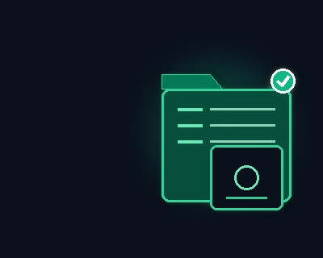
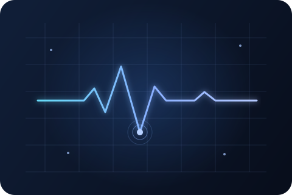
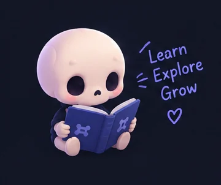

<div align="center">

# BoneVista

### 3D anatomy, made explorable.

**A browser-based anatomy and biomechanics workspace for learning by seeing, moving, and testing ideas.**

[](https://react.dev/)
[](https://threejs.org/)
[](https://www.typescriptlang.org/)
[](LICENSES.md)

<br />

[**Open BoneVista**](https://spixcy.github.io/BoneVista/) · [Explore the modules](#the-workspace) · [Run it locally](#run-locally)

<br />


</div>

---

BoneVista brings interactive anatomy models, guided study, physiology revision, radiograph viewing, and an educational biomechanics model into one workspace. Explore structures in 3D, compare anatomical layers, and connect what a structure looks like with how it works.

> **For education and exploration.** BoneVista is not a medical device. It does not diagnose, interpret radiographs, or guide treatment.

## At a glance

| 335+ | 437 | 255 | 6 |
|:---:|:---:|:---:|:---:|
| selectable skeletal structures | brain atlas structures | peripheral nerve structures | animated NEET PG physiology topics |

## The workspace

Each module opens in the same browser-based workspace. Models and tools are designed for interactive study; the notes below describe what is implemented today.

<table>
  <tr>
    <td width="33%" valign="top">
      
      <h3>🦴 3D Skeletal Atlas</h3>
      <p>Explore more than 335 named skeletal structures. Rotate, zoom, select, isolate, and switch between anatomical views.</p>
    </td>
    <td width="33%" valign="top">
      
      <h3>💪 Muscle Explorer</h3>
      <p>Move between bone, superficial, deep, and combined views of the segmented muscle atlas.</p>
    </td>
    <td width="33%" valign="top">
      
      <h3>🧠 Brain &amp; Neuro</h3>
      <p>Inspect the 3D brain and peripheral nervous system, browse named structures, and explore grouped pathways.</p>
    </td>
  </tr>
  <tr>
    <td width="33%" valign="top">
      
      <h3>〰️ Spine Explorer</h3>
      <p>Browse individually selectable vertebrae and move through cervical, thoracic, lumbar, sacral, and coccygeal regions.</p>
    </td>
    <td width="33%" valign="top">
      
      <h3>📊 Axial Stress Model</h3>
      <p>Adjust load and material inputs in a simplified 1D axial-bar finite-element model and view its result on a selected atlas bone.</p>
    </td>
    <td width="33%" valign="top">
      
      <h3>🩻 X-Ray Workspace</h3>
      <p>View AP and lateral images locally. Adjust zoom, pan, rotation, brightness, and contrast, then manually highlight a matching atlas bone.</p>
    </td>
  </tr>
  <tr>
    <td width="33%" valign="top">
      
      <h3>📖 Anatomy Study Guide</h3>
      <p>Follow seven short study paths into the atlas and use quick-recall questions to review core skeletal concepts.</p>
    </td>
    <td width="33%" valign="top">
      
      <h3>🎓 NEET PG Physiology</h3>
      <p>Watch six step-by-step physiology animations, review high-yield notes, and answer a practice MCQ for each topic.</p>
    </td>
    <td width="33%" valign="top">
      
      <h3>🔬 Bone Biology</h3>
      <p>Explore interactive lessons on the skeleton, bone structure, cells, growth, remodelling, fracture healing, and clinical correlations.</p>
    </td>
  </tr>
</table>

### NEET PG: physiology in motion

The revision area is built around visual explanations rather than a large question bank. Each topic pairs a motion graphic with narrated steps, high-yield review points, and one practice question with an explanation.

| Topic | What it covers |
|---|---|
| Neuron &amp; conduction | Threshold, myelination, and saltatory conduction |
| Action potential | Depolarisation, repolarisation, and refractory periods |
| Chemical synapse | Calcium-triggered release and neurotransmission |
| Stretch reflex | The knee-jerk reflex and reciprocal inhibition |
| Muscle contraction | Sliding filaments and excitation–contraction coupling |
| Cardiac conduction | The conduction pathway and its ECG sequence |

Animations include playback controls, speed settings, and clickable steps. The page is intended as a revision aid; it does not replace course texts or a full exam question bank.

### More ways to study

- **Bone biology lessons:** Interactive 3D teaching scenes with concise explanations and high-yield notes, from bone shapes and osteons to growth plates, remodelling, fracture healing, fracture sites, and clinical correlations.
- **Anatomy Study Guide:** Seven guided paths link concepts to the relevant workspace tools. Three quick-recall cards cover foundational skeletal anatomy.
- **Structure search:** Search available anatomy structures by English or Latin name and jump into the matching atlas entry.
- **Resources & Credits:** Browse dataset and software sources, license information, and attribution details.
- **Model exports:** Export the skeletal or muscle model as GLB or OBJ, or save a PDF summary of selected skeletal or muscle structures.
- **Workspace controls:** Use selection, isolation, layer visibility, camera controls, and full-screen viewing where supported by the active module.

## How the X-ray and stress tools work

These tools are intentionally educational and transparent about their limits:

- **Radiographs:** Images are loaded into the browser for local viewing. BoneVista does not upload or analyze them. You can manually choose a corresponding bone and open that structure highlighted in the existing skeleton atlas; no patient-specific 3D model is generated.
- **Axial stress:** The solver models a simplified, uniform 1D bar under an axial load. Its illustrative stress result can be mapped to a selected atlas mesh for visualization. It does not calculate patient-specific or full 3D bone stress.

## Run locally

**Requirements:** Node.js 20 or newer and a modern browser with WebGL support.

```bash
git clone https://github.com/spixcy/BoneVista.git
cd BoneVista
npm install
npm run dev
```

Vite prints the local development URL in the terminal (usually `http://localhost:5173`). To create and preview a production build:

```bash
npm run build
npm run preview
```

The repository also provides an end-to-end test command:

```bash
npm run test:e2e
```

## Built with

| Area | Tools |
|---|---|
| Interface | React, TypeScript, Vite, CSS Modules |
| 3D anatomy | Three.js, React Three Fiber, Drei, Draco-compressed models |
| State and interaction | Zustand, Framer Motion, Lucide |
| Radiograph viewing | Browser image rendering and local image controls |
| Study exports | GLTF/OBJ exporters and jsPDF |

## Privacy &amp; educational use

Radiographs are used for local viewing and manual reference matching in the browser. They are not sent to a reconstruction service, analyzed for findings, or used to generate anatomy. The stress solver is a teaching model with simplified assumptions. Do not use BoneVista for diagnosis, treatment decisions, or surgical planning.

## Data &amp; attribution

BoneVista combines application code with separately licensed anatomy datasets. Skeletal, muscle, brain, and nerve assets have their own source and attribution requirements; those terms do not all use the same license.

- Application code: **MIT**.
- Bundled anatomy assets: see the dataset-specific terms and notices; several are distributed under **CC BY-SA 4.0**.
- Full details: [`LICENSES.md`](LICENSES.md), [`THIRD-PARTY-NOTICES.md`](THIRD-PARTY-NOTICES.md), and the notices beside assets in `public/`.

Please preserve the relevant attribution and license terms when redistributing anatomy data.

## Contributing

Bug reports and focused improvements are welcome. To contribute:

1. Fork the repository and create a branch from `main` (`git switch -c fix/short-description`).
2. Make a focused change and add or update tests when behavior changes.
3. Run `npm run build` and `npm run test:e2e` before opening a pull request.
4. Open a pull request against `main`. Describe what changed and how you checked it.

For anatomy assets, include the source and required attribution and license details. Review [`LICENSES.md`](LICENSES.md) and [`THIRD-PARTY-NOTICES.md`](THIRD-PARTY-NOTICES.md) before redistributing model or atlas data.

---

<div align="center">

**BoneVista** · Explore anatomy. Understand the connections.

[Open the live workspace](https://spixcy.github.io/BoneVista/) · [Report an issue](https://github.com/spixcy/BoneVista/issues)

</div>
