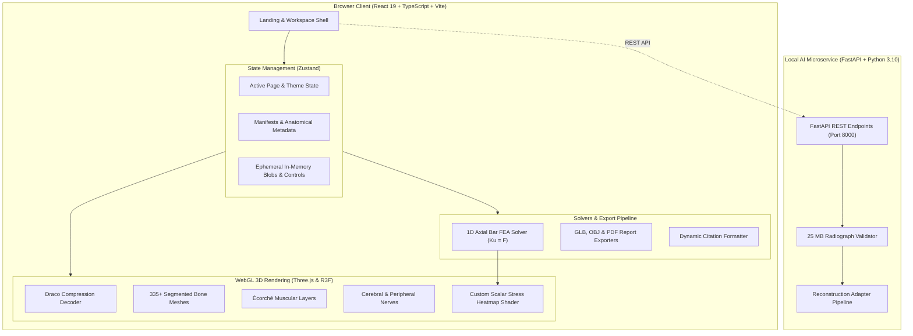

# <div align="center">🦴 BoneVista</div>

<div align="center">

**Next-Generation 3D Biomechanical & Anatomical Visualization Engine**  
*Segmented 3D Skeletal Atlas · Dual-Layer Muscle Écorché · Neuro & Brain Explorer · 1D Axial FEA Simulation · Bi-Planar Radiograph Studio · NEET-PG Prep*

[](https://react.dev/)
[](https://threejs.org/)
[](https://vitejs.dev/)
[](https://www.typescriptlang.org/)
[](https://www.python.org/)
[](https://fastapi.tiangolo.com/)
[](https://playwright.dev/)
[](LICENSES.md)

</div>

---

<p align="center">
  
</p>

<p align="center">
  <a href="#-key-features"><b>Features</b></a> •
  <a href="#-interactive-showcase"><b>Showcase</b></a> •
  <a href="#-system-architecture"><b>Architecture</b></a> •
  <a href="#-core-modules"><b>Modules</b></a> •
  <a href="#-fea-stress-solver"><b>FEA Engine</b></a> •
  <a href="#-fastapi-microservice"><b>AI Microservice</b></a> •
  <a href="#-quick-start"><b>Quick Start</b></a> •
  <a href="#-citations--provenance"><b>Citations</b></a> •
  <a href="#-clinical-disclaimer"><b>Disclaimer</b></a>
</p>

---

## 🌟 Overview

**BoneVista** is a comprehensive, client-first 3D anatomical learning and biomechanical exploration studio designed for medical trainees, biomedical engineers, anatomy researchers, and clinicians.

Built on **React 19**, **Three.js**, and **React Three Fiber**, BoneVista integrates high-fidelity segmented skeletal geometry, multi-layered muscle Écorché models, cerebral and peripheral neuroanatomy, interactive 1D axial Finite Element Analysis (FEA), a bi-planar radiograph workspace, and a high-yield medical quiz engine.

All rendering and interactive computations execute **100% locally in your browser** with zero external cloud telemetry, preserving complete privacy for educational datasets and user experiments.

> [!IMPORTANT]
> **Educational & Research Notice:** BoneVista is an educational demonstration and biomechanical modeling platform. It is **not** a certified medical device, diagnostic system, or surgical planning tool.

---

## ⚡ Key Highlights

- **💀 Segmented Skeletal Atlas:** 335+ individually selectable anatomical bones decoded via Draco compression, featuring 6 anatomical camera orientations (`Ant`, `Post`, `Lat-L`, `Lat-R`, `Sup`, `Inf`), single-click structure isolation, and glTF/OBJ/PDF report export.
- **🥩 Dual-Layer Muscle Écorché:** Dedicated Écorché model (`ecorche.glb`) with instant layer switches (`Bones`, `Superficial`, `Deep`, `Combined`), paired with synchronized anatomical taxonomy.
- **🧠 Neuro & Brain Explorer:** 437 named cerebral structures (`brain.glb`) and 255 peripheral nerve meshes (`nerves.glb`) organized into 44 functional neurological pathways with cranial nerve isolation.
- **🦴 Regional Spine Explorer:** Interactive vertebral column subdivided into Cervical (C1–C7), Thoracic (T1–T12), Lumbar (L1–L5), Sacrum, and Coccyx with synchronized biomechanical metadata.
- **🔬 1D Axial FEA Stress Solver:** Direct stiffness matrix assembly ($[K]\{u\} = \{F\}$) with Gaussian elimination, interactive load/area sliders, and live 0–10 MPa chromatic mesh heatmaps.
- **🩻 Bi-Planar Radiograph Studio:** Orthogonal Anteroposterior (AP) & Lateral X-ray viewing canvas with 10%–800% zoom, 90° rotation, brightness/contrast windowing, and anatomical registration tools.
- **📚 Resources & Credits Module:** An in-app citation repository with verified upstream GitHub repositories, license compliance records, and one-click citation copying (APA / Vancouver).
- **🎓 NEET-PG Medical Quiz:** Integrated high-yield anatomy question bank for competitive exam revision with instant rationales and anatomical cross-links.
- **🔒 Zero-Telemetry Privacy:** Images and files remain in client-side ephemeral memory (`blob:` URLs); display preferences are stored solely in local storage.

---

## 🎨 Interactive Showcase

<table align="center" width="100%">
  <tr>
    <td width="33%" align="center" valign="top">
      
      <br />
      <b>💀 3D Skeletal Atlas</b>
      <p>335+ segmented reference bones with 6-DOF camera controls, Draco decoding, and structure isolation.</p>
    </td>
    <td width="33%" align="center" valign="top">
      
      <br />
      <b>🥩 Muscle Explorer (Écorché)</b>
      <p>Superficial and deep muscular layers, paired skeleton-plus-muscles combined view, and camera targeting.</p>
    </td>
    <td width="33%" align="center" valign="top">
      
      <br />
      <b>🧠 Neuro & Brain Atlas</b>
      <p>437 cerebral structures and 255 peripheral nerve branches across 44 functional pathways.</p>
    </td>
  </tr>
  <tr>
    <td width="33%" align="center" valign="top">
      
      <br />
      <b>🦴 Spine Explorer</b>
      <p>Regionally filtered vertebral column: Cervical (C1–C7), Thoracic (T1–T12), Lumbar (L1–L5), Sacrum & Coccyx.</p>
    </td>
    <td width="33%" align="center" valign="top">
      
      <br />
      <b>🔬 1D Axial FEA Simulation</b>
      <p>Direct stiffness solver with real-time matrix assembly and live 0–10 MPa heatmapped mesh overlays.</p>
    </td>
    <td width="33%" align="center" valign="top">
      
      <br />
      <b>🩻 Bi-Planar Radiograph Studio</b>
      <p>Orthogonal AP/Lateral studio with 800% zoom, image enhancement, and FastAPI microservice hook.</p>
    </td>
  </tr>
</table>

---

## 📐 System Architecture

BoneVista coordinates a high-performance React 19 single-page application with static Draco-encoded glTF models, Zustand state coordination, Three.js shaders, and an optional local FastAPI microservice:



---

## 🛠️ Core Modules Breakdown

### 1. 💀 3D Skeletal Atlas
- **335+ Individually Segmented Bones:** Interactive hierarchy covering the axial and appendicular skeleton.
- **Draco Compression:** Sub-second model loading over standard connections with high geometric precision.
- **Perspective Presets:** Immediate camera snapping to Anterior, Posterior, Lateral Left, Lateral Right, Superior, and Inferior views.
- **3D Export Tools:** Export selected geometries to standard `.glb` or `.obj`, or compile an anatomical dossier as a `.pdf`.

### 2. 🥩 Muscle Explorer (Écorché)
- **Multi-Layer Stratification:** Toggle effortlessly between *Bones Only*, *Superficial Layer*, *Deep Layer*, and *Combined Écorché*.
- **Synchronized Focus:** Selecting a muscle automatically frames the camera, highlights origin and insertion anchors, and provides anatomical naming.

### 3. 🧠 Neuro & Brain Explorer
- **Comprehensive Functional Maps:** 437 named cerebral structures including cortical lobes, basal ganglia, brainstem, and cerebellum.
- **Peripheral Nerve Tree:** 255 peripheral nerve meshes structured across 44 clinical pathways with dedicated cranial nerve filtering (CN I–XII).

### 4. 🦴 Spine Explorer
- **Segment-Level Filtering:** Isolated examination of Cervical (C1–C7), Thoracic (T1–T12), Lumbar (L1–L5), and Sacrococcygeal segments.
- **Anatomical Details:** Facet orientation, vertebral body dimensions, and canal boundaries documented in real time.

### 5. 🔬 1D Axial FEA Stress Solver
- **Direct Stiffness Method:** Assembles element stiffness matrices $[k_e]$ into global $[K]$, applying boundary conditions and solving $[K]\{u\} = \{F\}$.
- **Dynamic Shader Mapping:** Displays mechanical stress $\sigma$ as an interactive scalar color ramp from Blue (0 MPa) $\to$ Cyan $\to$ Yellow $\to$ Red ($\ge 10\text{ MPa}$).

### 6. 🩻 Bi-Planar Radiograph Studio
- **Orthogonal Dual-Viewport:** Synchronized viewing of Anteroposterior (AP) and Lateral radiographic images.
- **Clinical Canvas Controls:** Pan, rotate in 90° increments, zoom from 10% to 800%, invert grayscale, and adjust brightness/contrast.
- **Bundled Teaching Data:** Includes an openly licensed hip arthroplasty radiograph pair for immediate evaluation.

### 7. 📚 Resources & Credits
- **Source Verification & Audit:** Complete documentation of upstream datasets, authors, and licenses.
- **Upstream Repository Links:** Direct links to original GitHub repositories and project sites.
- **One-Click Citation Engine:** Copy preformatted citations in standard APA and academic formats.

---

## 🔬 FEA Stress Engine Formulation

BoneVista incorporates an interactive 1D linear-elastic axial bar finite element solver to illustrate structural mechanics on biological geometry:

$$\mathbf{K} \mathbf{u} = \mathbf{F}$$

$$\text{Element Stiffness Matrix:} \quad \mathbf{k}_e = \frac{E A}{L_e} \begin{bmatrix} 1 & -1 \\ -1 & 1 \end{bmatrix}$$

$$\text{Axial Cauchy Stress:} \quad \sigma = E \varepsilon = E \frac{\Delta u}{L_e} = \frac{F}{A}$$

$$\text{Stress Heatmap Index:} \quad s = \text{clamp}\left( \frac{|\sigma|}{\sigma_{\max}}, 0, 1 \right) \quad \left(\text{where } \sigma_{\max} = 10\text{ MPa}\right)$$

```
  0 MPa (Blue)  ───>  3.3 MPa (Cyan)  ───>  6.6 MPa (Yellow)  ───>  10+ MPa (Red)
```

---

## ⚡ Local FastAPI Microservice

For local AI-assisted radiograph processing, BoneVista includes a decoupled Python FastAPI microservice located in `xray-reconstruction-service/`:

| Method | Endpoint | Description |
|---|---|---|
| `GET` | `/api/v1/health` | Healthcheck and service readiness status |
| `GET` | `/api/v1/reconstruction/capabilities` | Truthfully reports checkpoint availability and supported anatomies |
| `POST` | `/api/v1/reconstruction/jobs` | Submits orthogonal AP & Lateral radiographs for 3D reconstruction |
| `GET` | `/api/v1/reconstruction/jobs/{job_id}` | Polls reconstruction job status (`queued`, `processing`, `succeeded`, `failed`) |
| `GET` | `/api/v1/reconstruction/jobs/{job_id}/model.glb` | Downloads generated 3D glTF model |

> [!NOTE]
> **Truthful Capability Reporting:** By default, `/api/v1/reconstruction/capabilities` truthfully reports `available: false` unless a verified model checkpoint is installed locally. BoneVista never generates fabricated patient geometry.

---

## ⌨️ Viewport Navigation Shortcuts

| Input | Action |
|---|---|
| <kbd>Left Mouse Drag</kbd> | Orbit / Rotate 3D scene |
| <kbd>Right Mouse Drag</kbd> / <kbd>Shift + Drag</kbd> | Pan camera translationally |
| <kbd>Scroll Wheel</kbd> / <kbd>Pinch Gesture</kbd> | Continuous zoom in 3D / 10%–800% zoom in 2D |
| <kbd>Left Click Mesh</kbd> | Select anatomical structure & frame camera |
| <kbd>Click Background</kbd> | Clear selection & restore global overview |
| <kbd>Ant</kbd> / <kbd>Post</kbd> / <kbd>Lat</kbd> / <kbd>Sup</kbd> / <kbd>Inf</kbd> | Snap camera to standard anatomical perspectives |
| <kbd>Auto-Rotate</kbd> | Toggle smooth 360° turntable inspection |
| <kbd>Isolate</kbd> | Hide non-selected geometry |
| <kbd>Esc</kbd> | Exit fullscreen maximized view / dismiss modal |

---

## 🚀 Quick Start

### Prerequisites
- **Node.js** `18.x` or higher (`20.x` recommended)
- **npm** `9.x` or higher
- **Python** `3.10+` *(optional, for local microservice)*

### 1. Frontend Workspace Setup
```bash
# Clone the repository
git clone https://github.com/spixcy/BoneVista.git
cd BoneVista

# Install dependencies
npm install

# Start Vite local development server
npm run dev
```

Open your browser to `http://localhost:5173` and click **Launch App**.

### 2. Local FastAPI Microservice *(Optional)*
```bash
# Navigate to microservice directory
cd xray-reconstruction-service

# Create virtual environment
python -m venv .venv

# Activate environment (Windows PowerShell)
.\.venv\Scripts\Activate.ps1
# Or on macOS/Linux:
# source .venv/bin/activate

# Install dependencies
pip install -r requirements-dev.txt

# Start microservice on port 8000
python run.py
```

### 3. Automated Testing & Verification
```bash
# Run Playwright E2E integration test suite
npm run test:e2e

# Run TypeScript compilation and production build
npm run build
```

---

## 📁 Repository Structure

```
BoneVista/
├── public/                         # Static assets & 3D model files
│   ├── anatomy/                    # Draco-encoded glTF skeleton & manifest
│   ├── muscle-atlas/               # Écorché muscular glTF & structure manifests
│   ├── neuro/                      # Brain & peripheral nerve glTF meshes
│   ├── branding/                   # App banners, cards, and mascot assets
│   └── test-images/                # Teaching radiograph pairs (AP & Lateral)
├── src/
│   ├── components/                 # React UI components
│   │   ├── AnatomicalScene/        # Three.js / R3F Canvas & Camera Controls
│   │   ├── Dashboard/              # Interactive landing & overview panels
│   │   ├── MuscleExplorer/         # Muscle layer controls & taxonomy cards
│   │   ├── NeuroExplorer/          # Brain structure tree & pathway filter
│   │   ├── ResourcesCredits/       # Citation engine & license audit modal
│   │   ├── Sidebar/                # Application navigation rail
│   │   ├── SpineExplorer/          # Vertebral column region filter
│   │   ├── StressAnalysis/         # 1D Axial FEA calculation & heatmaps
│   │   └── XrayWorkspace/          # Orthogonal AP/Lateral radiograph viewer
│   ├── data/                       # Verified anatomical data & citations
│   │   ├── resources/              # Upstream source registries & citation formatters
│   │   ├── neuroAtlas.ts           # Neurological pathway database
│   │   └── spineData.ts            # Vertebral taxonomy & biomechanics
│   ├── store/                      # Zustand state stores
│   │   ├── appStore.ts             # Workspace state & active modules
│   │   └── useMuscleStore.ts       # Muscle explorer selection & layer presets
│   ├── App.tsx                     # Top-level routing & layout coordinator
│   └── main.tsx                    # React DOM entry point
├── tests/                          # Playwright end-to-end test suites
├── xray-reconstruction-service/    # Decoupled FastAPI Python microservice
├── LICENSES.md                     # Comprehensive copyleft & open-source licenses
└── README.md                       # Repository documentation
```

---

## 📜 Citations & Provenance

BoneVista is made possible by open anatomical datasets, scientific research, and open-source software:

| Asset / Component | Primary Source & Authors | Upstream Repository / Site | License |
|---|---|---|---|
| **Skeletal Geometry** | Z-Anatomy (Gauthier Kervyn et al.) & DBCLS BodyParts3D | [Z-Anatomy/Atlas](https://github.com/Z-Anatomy/Atlas) | [CC BY-SA 4.0](https://creativecommons.org/licenses/by-sa/4.0/) |
| **Muscle Atlas (Écorché)** | Écorché Anatomy (Charleeh) & DBCLS | [Charleeh/ecorche](https://github.com/Charleeh/ecorche) | [CC BY-SA 4.0](https://creativecommons.org/licenses/by-sa/4.0/) |
| **Brain Atlas** | Brain Project / CIT168 Human Brain Template | [Sketchfab / Brain Project](https://sketchfab.com/3d-models/brain-project) | [CC BY-SA 4.0](https://creativecommons.org/licenses/by-sa/4.0/) |
| **Peripheral Nerves** | Human Anatomy Project & CAHID Dundee | [3D Human Body Anatomy](https://sketchfab.com/3d-models/human-anatomy) | [CC BY-SA 4.0](https://creativecommons.org/licenses/by-sa/4.0/) |
| **Anatomical Nomenclature**| Terminologia Anatomica 2 (FIPAT) | [FIPAT Library](https://fipat.library.dal.ca/ta2/) | International Medical Standard |
| **Three.js & R3F** | Ricardo Cabello (mrdoob) & Poimandres | [mrdoob/three.js](https://github.com/mrdoob/three.js) | [MIT License](https://opensource.org/licenses/MIT) |
| **BoneVista Application** | BoneVista Contributors | [spixcy/BoneVista](https://github.com/spixcy/BoneVista) | [MIT License](LICENSES.md) |

Detailed attribution records and license texts are maintained in [`LICENSES.md`](LICENSES.md) and accessible in-app via the **Resources & Credits** module.

---

## 🔒 Data Privacy & Security

- **Local-First Execution:** Uploaded radiographs are loaded as ephemeral browser memory references (`blob:` object URLs) and released upon session termination.
- **Zero Cloud Transmission:** No patient identifiers, uploaded imagery, or analytical telemetry leave your device.
- **Client-Side File Generation:** Exported 3D geometry (`.glb`, `.obj`) and summary documents (`.pdf`) are synthesized entirely in browser memory.
- **Transparent Persistence:** User display preferences (e.g. night/day theme) reside exclusively in browser `localStorage`.

---

## ⚠️ Clinical Disclaimer

> [!CAUTION]
> **NOT A MEDICAL DEVICE.** BoneVista is developed strictly for educational demonstration, biomechanical software exploration, and computer graphics research.
>
> - BoneVista does **not** diagnose medical conditions, detect fractures, or provide clinical guidance.
> - Radiograph uploads do **not** construct clinical patient-specific anatomical meshes.
> - The 1D FEA stress solver is an idealized educational calculation; it does **not** calculate 3D structural stress tensors or predict implant osseointegration.
> - Never utilize BoneVista for clinical diagnosis, patient management, or surgical intervention. Always consult a licensed medical professional.

---

## 🤝 Contributing

Contributions, feature requests, and issue reports are welcome!

1. Fork the repository (`https://github.com/spixcy/BoneVista/fork`).
2. Create a feature branch: `git checkout -b feature/amazing-feature`.
3. Commit your changes: `git commit -m 'feat: add amazing feature'`.
4. Push to your branch: `git push origin feature/amazing-feature`.
5. Open a Pull Request against the `Ui` branch.

Please ensure all tests pass (`npm run test:e2e`) and TypeScript builds cleanly (`npm run build`) before opening a PR.

---

<div align="center">


**BoneVista** — Crafted with 🦴 for anatomy learners, bioengineers, and researchers.  
⭐ **Star this repository on GitHub if you find it helpful!**

</div>
