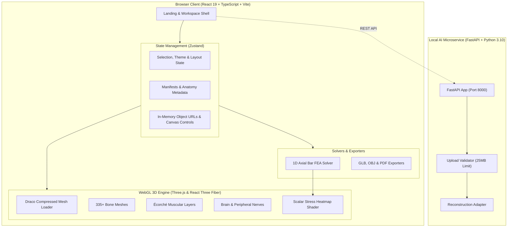
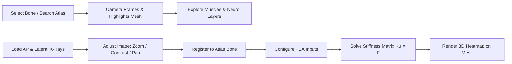

# <div align="center">🦴 BoneVista</div>

<div align="center">

**Next-Generation 3D Biomechanical & Anatomical Visualization Engine**  
*Segmented 3D Skeletal Atlas · Dual-Layer Muscle Écorché · Neuro & Brain Explorer · 1D Axial FEA Simulation · Bi-Planar Radiograph Studio*

[](https://react.dev/)
[](https://threejs.org/)
[](https://vitejs.dev/)
[](https://www.typescriptlang.org/)
[](https://www.python.org/)
[](https://fastapi.tiangolo.com/)
[](https://playwright.dev/)
[](LICENSES.md)

</div>

---

<p align="center">
  
</p>

<p align="center">
  <a href="#-interactive-showcase"><b>Showcase</b></a> •
  <a href="#-core-modules"><b>Core Modules</b></a> •
  <a href="#-system-architecture"><b>Architecture</b></a> •
  <a href="#-fea-stress-engine"><b>FEA Engine</b></a> •
  <a href="#-fastapi-microservice"><b>FastAPI Microservice</b></a> •
  <a href="#-quick-start"><b>Quick Start</b></a> •
  <a href="#-clinical-disclaimer"><b>Disclaimer</b></a>
</p>

---

## 🌟 Overview

**BoneVista** is a browser-based 3D anatomical learning and biomechanical exploration engine built with **React 19**, **Three.js**, and **React Three Fiber**. It combines segmented 3D skeletal geometry, deep/superficial muscle Écorché layers, cerebral and peripheral neuroanatomy, an educational 1D axial Finite Element Analysis (FEA) solver, and a bi-planar radiograph workspace.

All processing runs **locally in the browser** or through an optional local FastAPI microservice—ensuring zero data leakage and total privacy.

> [!IMPORTANT]
> **Educational & Research Notice:** BoneVista is an educational prototype and software demonstration platform. It is **not** a clinical diagnostic tool, medical device, or surgical treatment planner.

---

## 🎨 Interactive Showcase

<table align="center" width="100%">
  <tr>
    <td width="33%" align="center" valign="top">
      
      <br />
      <b>💀 3D Skeletal Atlas</b>
      <p>335+ segmented reference bones with 6-DOF camera controls, Draco compression, and single-click structure isolation.</p>
    </td>
    <td width="33%" align="center" valign="top">
      
      <br />
      <b>🥩 Muscle Explorer (Écorché)</b>
      <p>Superficial & deep muscular layers, paired skeleton-plus-muscles combined view, and synchronized camera focus.</p>
    </td>
    <td width="33%" align="center" valign="top">
      
      <br />
      <b>🧠 Neuro & Brain Atlas</b>
      <p>437 named cerebral structures & 255 peripheral nerves catalogued into 44 functional pathways.</p>
    </td>
  </tr>
  <tr>
    <td width="33%" align="center" valign="top">
      
      <br />
      <b>🦴 Spine Explorer</b>
      <p>Regionally filtered vertebral column: Cervical (C1–C7), Thoracic (T1–T12), Lumbar (L1–L5), Sacrum & Coccyx.</p>
    </td>
    <td width="33%" align="center" valign="top">
      
      <br />
      <b>🔬 1D Axial FEA Simulation</b>
      <p>Direct stiffness solver with live matrix assembly and real-time 0–10 MPa heatmapped mesh overlays.</p>
    </td>
    <td width="33%" align="center" valign="top">
      
      <br />
      <b>🩻 Bi-Planar Radiograph Studio</b>
      <p>Orthogonal AP/Lateral viewing studio with 800% zoom, image enhancement, and FastAPI microservice hook.</p>
    </td>
  </tr>
</table>

---

## ⚡ Core Modules

- 💀 **3D Skeletal Atlas:** 335+ segmented reference bones, Draco geometry decoding, 6 camera presets (`Ant`, `Post`, `Lat L/R`, `Sup`, `Inf`), single-click isolation, and GLB/OBJ/PDF exports.
- 🥩 **Muscle Explorer (Écorché):** Dedicated 14 MB Écorché model (`ecorche.glb`) with dynamic layer presets (`Bones`, `Superficial`, `Deep`, `Combined`) and unified camera targeting.
- 🧠 **Neuro & Brain Explorer:** 437 named cerebral structures (`brain.glb`) and 255 peripheral nerve meshes (`nerves.glb`) across 44 functional catalogues, plus cranial nerve toggles.
- 🦴 **Spine Explorer:** Regionally segmented vertebral column (C1–C7, T1–T12, L1–L5, Sacrum, Coccyx) synchronized live with 3D viewport selection.
- 🔬 **1D Axial FEA Stress Solver:** Direct stiffness method matrix assembly ($[K]\{u\} = \{F\}$) with live Gaussian elimination and real-time 0–10 MPa heatmapped mesh rendering.
- 🩻 **Bi-Planar Radiograph Studio:** Orthogonal AP/Lateral radiograph viewer with 10%–800% zoom, 90° rotation, contrast/brightness sliders, and manual anatomical registration.
- ⚡ **Local AI Microservice:** Decoupled FastAPI backend for local, privacy-first bi-planar X-ray to 3D reconstruction.
- 📚 **Resources & Credits:** A compact, searchable library of every anatomy dataset, research reference, and open-source library powering BoneVista — with individual source links, verified license records, and one-click citation copying. See [LICENSES.md](LICENSES.md) for full attribution terms.

<details>
<summary><b>🔍 View Included Hip Arthroplasty Teaching Dataset</b></summary>
<br />
<table align="center">
  <tr>
    <td align="center">
      <br />
      <sub><b>Anteroposterior (AP) View</b></sub>
    </td>
    <td align="center">
      <br />
      <sub><b>Lateral View</b></sub>
    </td>
  </tr>
  <tr>
    <td colspan="2" align="center">
      <sub>Openly licensed clinical hip-replacement pair included for instant image workspace testing.</sub>
    </td>
  </tr>
</table>
</details>

---

## 📐 System Architecture

BoneVista coordinates a React 19 frontend with static Draco-encoded glTF models and a Python FastAPI backend.



### Analysis Workflow



---

## 🔬 FEA Stress Engine

BoneVista features a linear-elastic 1D axial bar finite element solver to demonstrate structural mechanics directly on biological structures:

$$\mathbf{K} \mathbf{u} = \mathbf{F}, \quad k_e = \frac{E A}{L_e} \begin{bmatrix} 1 & -1 \\ -1 & 1 \end{bmatrix}, \quad \sigma = E \varepsilon = \frac{F}{A}$$

$$\text{Stress Heatmap} = \text{clamp}\left( \frac{|\sigma|}{10\text{ MPa}}, 0, 1 \right) \quad \longrightarrow \quad \text{Blue} \to \text{Cyan} \to \text{Yellow} \to \text{Red}$$

<details>
<summary><b>📐 View Finite Element Formulation Details</b></summary>
<br />

1. **Element Discretization:** The shaft of length $L$ is discretized into $N$ linear elements ($1 \le N \le 100$) of length $L_e = L / N$.
2. **Global Stiffness Assembly:** 2-node stiffness matrices $[k_e]$ are assembled into global $[K] \in \mathbb{R}^{(N+1) \times (N+1)}$.
3. **Boundary Conditions:** Node 0 is fixed ($u_0 = 0$), and axial force $F$ is applied to node $N$.
4. **Solution:** Displacements $\{u\}$ are solved via Gaussian elimination with back-substitution to compute elemental strain $\varepsilon$ and axial Cauchy stress $\sigma$.
</details>

---

## ⚡ FastAPI Microservice

An isolated Python backend (`xray-reconstruction-service/`) handles bi-planar X-ray to 3D reconstruction requests locally:

| Method | Endpoint | Description |
|---|---|---|
| `GET` | `/api/v1/health` | Returns service status and health payload |
| `GET` | `/api/v1/reconstruction/capabilities` | Truthfully reports model availability and supported anatomies |
| `POST` | `/api/v1/reconstruction/jobs` | Submits bi-planar AP & Lateral radiographs for 3D reconstruction |
| `GET` | `/api/v1/reconstruction/jobs/{job_id}` | Polls reconstruction job status (`queued`, `processing`, `succeeded`, `failed`) |
| `GET` | `/api/v1/reconstruction/jobs/{job_id}/model.glb` | Downloads reconstructed 3D GLB model |

> [!NOTE]
> **Truthful Capability Reporting:** By default, `GET /api/v1/reconstruction/capabilities` returns `available: false` until a verified checkpoint is loaded. It never fabricates patient anatomy.

---

## ⌨️ Viewport Shortcuts

| Input | Action |
|---|---|
| <kbd>Left Drag</kbd> | Orbit / Rotate camera |
| <kbd>Right Drag</kbd> / <kbd>Shift + Drag</kbd> | Pan camera laterally and vertically |
| <kbd>Wheel</kbd> / <kbd>Pinch</kbd> | Smooth Zoom (10% to 800% in 2D / continuous in 3D) |
| <kbd>Click Mesh</kbd> | Select structure, frame camera, and display taxonomy |
| <kbd>Click Background</kbd> | Clear selection |
| <kbd>Ant</kbd> / <kbd>Post</kbd> / <kbd>Lat</kbd> / <kbd>Sup</kbd> / <kbd>Inf</kbd> | Snap camera to standard anatomical perspectives |
| <kbd>Auto Rotate</kbd> | Toggle 360° inspection rotation |
| <kbd>Isolate</kbd> | Hide unselected anatomy |
| <kbd>Esc</kbd> | Exit fullscreen maximized workspace |

---

## 🚀 Quick Start

### 1. Frontend Workspace
```bash
git clone https://github.com/spixcy/BoneVista.git
cd BoneVista
npm install
npm run dev
```
Open `http://localhost:5173` and click **Launch App**.

### 2. Local FastAPI Microservice *(Optional)*
```powershell
cd xray-reconstruction-service
python -m venv .venv
.\.venv\Scripts\Activate.ps1
pip install -r requirements-dev.txt
python run.py
```
Microservice runs locally at `http://127.0.0.1:8000`.

### 3. Automated Testing
```bash
npm run test:e2e    # Run Playwright E2E tests
npm run build       # Production TypeScript & Vite build
```

---

## 🔒 Data Privacy & Security

- **Client-Side Execution:** Radiographs are loaded in browser memory as ephemeral `blob:` object URLs.
- **Zero Cloud Leakage:** No images, scan metadata, or user telemetry are transmitted to external servers.
- **Local Persistence:** Display themes (`bonevista-theme`) are stored exclusively in the browser's `localStorage`.
- **Client-Generated Exports:** GLB, OBJ, and PDF files are generated dynamically in-memory and saved directly to your device.

---

## ⚠️ Clinical Disclaimer

> [!CAUTION]
> **NOT A MEDICAL DEVICE.** BoneVista is developed exclusively for educational demonstration, biomechanical software exploration, and computer graphics research.
>
> - BoneVista does **not** diagnose pathology, detect fractures, or provide medical advice.
> - Radiograph uploads do **not** generate clinical patient meshes.
> - The 1D FEA solver is an idealized educational calculation; it does **not** model clinical 3D stress tensors or implant stability.
> - Never use BoneVista for clinical diagnosis or treatment planning. Always consult qualified healthcare professionals.

---

## 📜 Attributions & Licenses

| Dataset / Asset | Source / Author | License | Description |
|---|---|---|---|
| **Skeletal Atlas** | [Z-Anatomy](https://www.z-anatomy.com/) / [BodyParts3D](https://dbarchive.biosciencedbc.jp/en/bodyparts3d/) | [CC BY-SA 4.0](https://creativecommons.org/licenses/by-sa/4.0/) | 335+ segmented bone meshes |
| **Muscle Atlas (Écorché)** | [Charleeh / ecorche](https://github.com/Charleeh/ecorche) | [CC BY-SA 4.0](https://creativecommons.org/licenses/by-sa/4.0/) | Superficial & deep muscular hierarchy |
| **Brain Atlas** | [Brain Project](https://sketchfab.com/3d-models/brain-project) | [CC BY-SA 4.0](https://creativecommons.org/licenses/by-sa/4.0/) | 437 named cerebral structures |
| **Peripheral Nerves** | [3D Human Body Anatomy](https://sketchfab.com/3d-models/human-anatomy) | [CC BY-SA 4.0](https://creativecommons.org/licenses/by-sa/4.0/) | Full-body nerve tree (255 meshes) |
| **Hip Arthroplasty X-Rays** | Open Teaching Dataset | Open Access | Orthogonal AP & Lateral test radiographs |
| **BoneVista Codebase** | BoneVista Contributors | [MIT License](LICENSES.md) | Application source code & UI components |

Full copyleft and license notices are documented in [`LICENSES.md`](LICENSES.md), [`THIRD-PARTY-NOTICES.md`](THIRD-PARTY-NOTICES.md), and [`public/neuro/NOTICE.md`](public/neuro/NOTICE.md).

---

<div align="center">

Crafted with 🦴 for anatomy learners, bioengineers, and researchers.  
⭐ **Star BoneVista on GitHub if you found it useful!**

</div>
