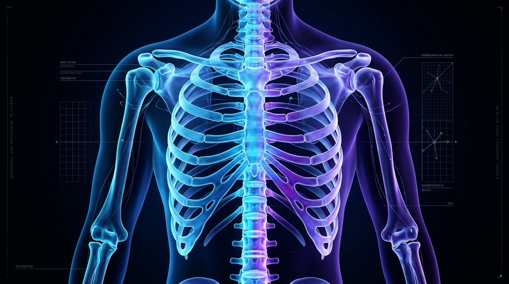
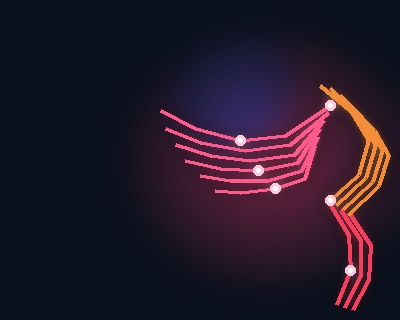
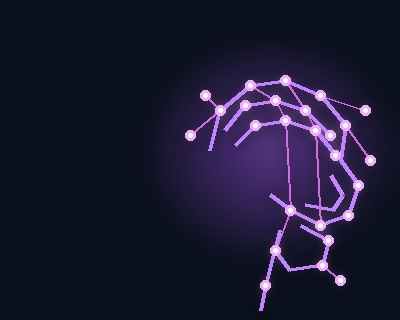
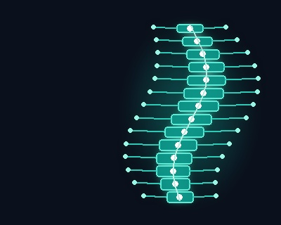
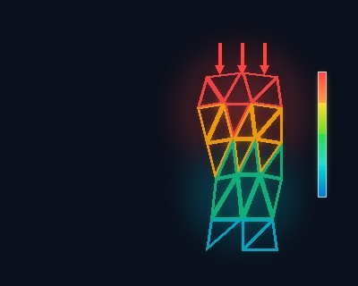
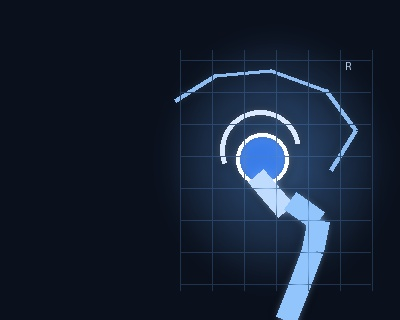
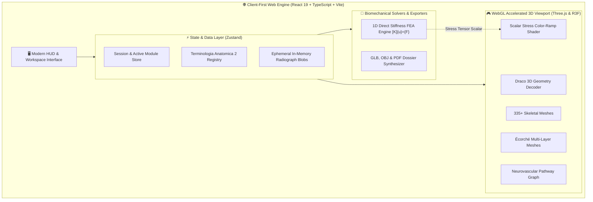
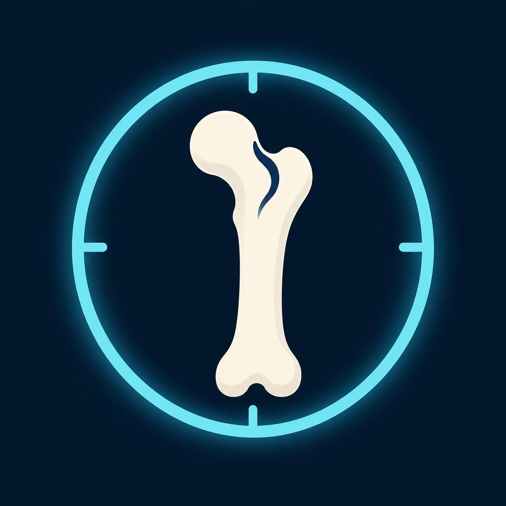

<div align="center">

# 🦴 BoneVista

### Next-Generation 3D Biomechanical & Anatomical Visualization Engine

**The Web-Native Medical Intelligence & Biomechanical Simulation Studio**  
*Segmented 3D Skeletal Atlas · Dual-Layer Muscle Écorché · Brain & Neuro Pathway Explorer · 1D Axial FEA Simulation · Bi-Planar Radiograph Studio · NEET-PG Prep*

<br />

[](https://react.dev/)
[](https://threejs.org/)
[](https://vitejs.dev/)
[](https://www.typescriptlang.org/)
[](https://developer.mozilla.org/en-US/docs/Web/API/WebGL2RenderingContext)
[](#-data-privacy--security)
[](LICENSES.md)

<br />

<!-- Action CTAs -->
<p align="center">
  <a href="https://spixcy.github.io/BoneVista/">
    
  </a>
  &nbsp;&nbsp;
  <a href="#-interactive-showcase">
    
  </a>
  &nbsp;&nbsp;
  <a href="#-fea-stress-engine-formulation">
    
  </a>
</p>

</div>

---

<p align="center">
  
</p>

<p align="center">
  <a href="#-overview"><b>Overview</b></a> •
  <a href="#-interactive-showcase"><b>Visual Showcase</b></a> •
  <a href="#-key-capabilities"><b>Capabilities</b></a> •
  <a href="#-system-architecture"><b>Architecture</b></a> •
  <a href="#-fea-stress-engine-formulation"><b>FEA Engine</b></a> •
  <a href="#-viewport-controls"><b>Controls</b></a> •
  <a href="#-citations--scientific-provenance"><b>Citations</b></a> •
  <a href="#-clinical-disclaimer"><b>Disclaimer</b></a>
</p>

---

## 🌟 Overview

**BoneVista** is a client-first, high-performance 3D anatomical learning and biomechanical exploration studio designed for medical trainees, biomedical engineers, anatomy researchers, and clinicians.

Built on **React 19**, **Three.js**, and **React Three Fiber**, BoneVista unites high-fidelity segmented skeletal geometry, multi-layered muscle Écorché models, cerebral and peripheral neuroanatomy, real-time 1D axial Finite Element Analysis (FEA), a bi-planar radiograph studio, and high-yield NEET-PG medical revision modules.

All 3D rendering and mathematical solvers execute **100% locally in your browser** via hardware-accelerated WebGL with zero external cloud telemetry — guaranteeing instant response times and absolute data privacy.

> [!IMPORTANT]
> **Educational & Research Notice:** BoneVista is an educational demonstration and biomechanical exploration platform. It is **not** a certified medical device, diagnostic system, or surgical planning tool.

---

## 🎨 Interactive Showcase

<table align="center" width="100%">
  <tr>
    <td width="33%" align="center" valign="top">
      
      <br />
      <h3>💀 3D Skeletal Atlas</h3>
      <p align="left">335+ segmented reference bones with 6-DOF camera orbits, Draco geometry decoding, multi-axis slicing, and structure isolation.</p>
    </td>
    <td width="33%" align="center" valign="top">
      
      <br />
      <h3>🥩 Muscle Écorché</h3>
      <p align="left">Dynamic stratification between Superficial, Deep, and Combined muscular layers with origin/insertion targeting and biomechanical anchors.</p>
    </td>
    <td width="33%" align="center" valign="top">
      
      <br />
      <h3>🧠 Neuro & Brain Atlas</h3>
      <p align="left">437 named cerebral structures and 255 peripheral nerve branches cataloged across 44 functional neurological pathways and cranial nerve filters.</p>
    </td>
  </tr>
  <tr>
    <td width="33%" align="center" valign="top">
      
      <br />
      <h3>🦴 Spine Explorer</h3>
      <p align="left">Regionally filtered vertebral column: Cervical (C1–C7), Thoracic (T1–T12), Lumbar (L1–L5), Sacrum, and Coccyx with curvature kinematics.</p>
    </td>
    <td width="33%" align="center" valign="top">
      
      <br />
      <h3>🔬 1D Axial FEA Solver</h3>
      <p align="left">Real-time Direct Stiffness Matrix solver with dynamic load/area sliders and live chromatic stress heatmaps (0–10+ MPa).</p>
    </td>
    <td width="33%" align="center" valign="top">
      
      <br />
      <h3>🩻 Radiograph Studio</h3>
      <p align="left">Orthogonal AP/Lateral viewing studio with 800% zoom, dynamic windowing (contrast/brightness), and anatomical bone registration.</p>
    </td>
  </tr>
</table>

---

## ⚡ Key Capabilities

```
  ┌────────────────────────────────────────────────────────────────────────────────────────┐
  │                                   BONEVISTA CORE MATRIX                                │
  ├───────────────────────┬────────────────────────────────────────────────────────────────┤
  │ 💀 Skeletal System    │ 335+ Draco-compressed meshes · 6 anatomical views · Isolation   │
  │ 🥩 Muscular Écorché   │ 4-layer view (Bones, Superficial, Deep, Combined)              │
  │ 🧠 Neurovascular      │ 437 brain structures · 255 peripheral nerves · 44 pathways     │
  │ 🦴 Vertebral Column   │ Cervical, Thoracic, Lumbar, Sacrococcygeal segmentation        │
  │ 🔬 Biomechanics (FEA) │ Direct stiffness [K]{u}={F} · 0–10 MPa live scalar shader      │
  │ 🩻 Medical Imaging    │ Bi-planar AP/Lateral viewer · 10%–800% zoom · Grayscale LUT    │
  │ 🎓 NEET-PG Revision   │ High-yield physiology modules, action potentials & MCQs       │
  │ 💾 Export Suite       │ Single-click export to 3D (.glb / .obj) and clinical .pdf      │
  └───────────────────────┴────────────────────────────────────────────────────────────────┘
```

- **💀 Segmented Skeletal Atlas:** 335+ individually selectable anatomical bones decoded via Draco compression, featuring 6 anatomical camera orientations (`Ant`, `Post`, `Lat-L`, `Lat-R`, `Sup`, `Inf`), single-click structure isolation, and 3D geometry export.
- **🥩 Dual-Layer Muscle Écorché:** Dedicated Écorché model (`ecorche.glb`) with instant layer switches (`Bones`, `Superficial`, `Deep`, `Combined`), paired with synchronized anatomical taxonomy.
- **🧠 Neuro & Brain Explorer:** 437 named cerebral structures (`brain.glb`) and 255 peripheral nerve meshes (`nerves.glb`) organized into 44 functional neurological pathways with cranial nerve isolation.
- **🦴 Regional Spine Explorer:** Interactive vertebral column subdivided into Cervical (C1–C7), Thoracic (T1–T12), Lumbar (L1–L5), Sacrum, and Coccyx with synchronized biomechanical metadata.
- **🔬 1D Axial FEA Stress Solver:** Direct stiffness matrix assembly ($[K]\{u\} = \{F\}$) with Gaussian elimination, interactive load/area sliders, and live 0–10 MPa chromatic mesh heatmaps.
- **🩻 Bi-Planar Radiograph Studio:** Orthogonal Anteroposterior (AP) & Lateral X-ray viewing canvas with 10%–800% zoom, 90° rotation, brightness/contrast windowing, and anatomical registration tools.
- **📚 Resources & Credits Module:** An in-app citation repository with verified upstream GitHub repositories, license compliance records, and one-click citation copying (APA / Vancouver).
- **🎓 NEET-PG Medical Revision:** Integrated high-yield physiology lessons covering action potentials, neural conduction, synaptic transmission, reflexes, muscle excitation, and cardiac conduction.

---

## 🏛️ System Architecture

BoneVista runs entirely client-side as an integrated, reactive single-page graphics engine:



### Architectural Breakdown

| Layer | Technologies | Responsibilities |
|---|---|---|
| **Presentation & HUD** | React 19, Tailwind CSS, Lucide Icons | Responsive medical console, drawer layouts, dark-mode styling |
| **3D Rendering Engine** | Three.js r186, React Three Fiber, Drei | High-framerate WebGL pipeline, custom shaders, OrbitControls |
| **Geometry Optimization** | Google Draco GLTF Extension | Sub-second streaming and decoding of complex skeletal geometry |
| **Reactive State** | Zustand | Zero-overhead decoupled state for selections, layers, and viewports |
| **Mathematical Solver** | Pure TypeScript Matrix Algorithms | Direct stiffness matrix formulation, Gaussian elimination for 1D FEA |
| **Imaging Engine** | HTML5 Canvas 2D Context | High-resolution AP/Lateral pixel mapping, contrast/brightness windowing |

---

## 🔬 FEA Stress Engine Formulation

BoneVista incorporates an interactive 1D linear-elastic axial bar finite element solver to illustrate structural mechanics directly on biological geometry:

$$\mathbf{K} \mathbf{u} = \mathbf{F}$$

$$\text{Element Stiffness Matrix:} \quad \mathbf{k}_e = \frac{E A}{L_e} \begin{bmatrix} 1 & -1 \\ -1 & 1 \end{bmatrix}$$

$$\text{Axial Cauchy Stress:} \quad \sigma = E \varepsilon = E \frac{\Delta u}{L_e} = \frac{F}{A}$$

$$\text{Stress Heatmap Index:} \quad s = \text{clamp}\left( \frac{|\sigma|}{\sigma_{\max}}, 0, 1 \right) \quad \left(\text{where } \sigma_{\max} = 10\text{ MPa}\right)$$

```
   0 MPa (Cool Blue) ────> 3.3 MPa (Cyan) ────> 6.6 MPa (Yellow) ────> 10+ MPa (Critical Red)
   [=======================  CHROMATIC STRESS GRADIENT  =======================]
```

The computed scalar stress value is mapped dynamically onto the mesh via a custom Fragment Shader, allowing students and engineers to observe real-time biomechanical load distributions under axial compression.

---

## 🎮 Viewport Navigation & Shortcuts

| Input | Action |
|---|---|
| <kbd>Left Mouse Drag</kbd> | Orbit / Rotate 3D scene in spherical coordinates |
| <kbd>Right Mouse Drag</kbd> / <kbd>Shift + Drag</kbd> | Pan camera translationally across the focal plane |
| <kbd>Scroll Wheel</kbd> / <kbd>Pinch Gesture</kbd> | Smooth continuous 3D zoom / 10%–800% radiograph zoom |
| <kbd>Left Click Mesh</kbd> | Select anatomical structure & auto-center focus |
| <kbd>Click Background</kbd> | Clear selection & restore global overview |
| <kbd>Ant</kbd> / <kbd>Post</kbd> / <kbd>Lat</kbd> / <kbd>Sup</kbd> / <kbd>Inf</kbd> | Instant snap to standard anatomical camera projections |
| <kbd>Auto-Rotate</kbd> | Toggle smooth 360° turntable anatomical inspection |
| <kbd>Isolate</kbd> | Temporarily cull unselected structures from the scene |
| <kbd>Esc</kbd> | Dismiss active drawer, reset filters, or exit full screen |

---

## 🚀 Live Access & Developer Setup

### 🌐 Instant Web Experience
BoneVista is deployed live as a zero-installation, progressive web application. Simply visit the link below in any browser with WebGL enabled:

**👉 [Launch BoneVista Live Studio](https://spixcy.github.io/BoneVista/)**

---

<details>
<summary><b>🛠️ Local Developer Setup (Optional)</b></summary>
<br />

If you wish to run BoneVista locally or contribute to its codebase:

```bash
# 1. Clone the repository
git clone https://github.com/spixcy/BoneVista.git
cd BoneVista

# 2. Install dependencies (Node 20+ recommended)
npm install

# 3. Start the local Vite development server
npm run dev
```

The application will spin up instantly at `http://localhost:5173`.

</details>

---

## 📜 Citations & Scientific Provenance

BoneVista is made possible by open scientific datasets, peer-reviewed medical repositories, and open-source software:

| Asset / Dataset | Primary Source & Authors | Upstream Repository / Authority | License |
|---|---|---|---|
| **Skeletal Geometry** | Z-Anatomy (Gauthier Kervyn et al.) & DBCLS BodyParts3D | [Z-Anatomy/Atlas](https://github.com/Z-Anatomy/Atlas) | [CC BY-SA 4.0](https://creativecommons.org/licenses/by-sa/4.0/) |
| **Muscle Atlas (Écorché)** | Écorché Anatomy (Charleeh) & DBCLS | [Charleeh/ecorche](https://github.com/Charleeh/ecorche) | [CC BY-SA 4.0](https://creativecommons.org/licenses/by-sa/4.0/) |
| **Brain Atlas** | Brain Project / CIT168 Human Brain Template | [Sketchfab / Brain Project](https://sketchfab.com/3d-models/brain-project) | [CC BY-SA 4.0](https://creativecommons.org/licenses/by-sa/4.0/) |
| **Peripheral Nerves** | Human Anatomy Project & CAHID Dundee | [3D Human Body Anatomy](https://sketchfab.com/3d-models/human-anatomy) | [CC BY-SA 4.0](https://creativecommons.org/licenses/by-sa/4.0/) |
| **Anatomical Taxonomy** | Terminologia Anatomica 2 (FIPAT) | [FIPAT Official Standard](https://fipat.library.dal.ca/ta2/) | International Medical Standard |
| **Graphics Core** | Three.js (Ricardo Cabello) & R3F (Poimandres) | [mrdoob/three.js](https://github.com/mrdoob/three.js) | [MIT License](https://opensource.org/licenses/MIT) |
| **BoneVista Application** | BoneVista Contributors | [spixcy/BoneVista](https://github.com/spixcy/BoneVista) | [MIT License](LICENSES.md) |

Detailed attribution records and license texts are maintained in [`LICENSES.md`](LICENSES.md) and [`THIRD-PARTY-NOTICES.md`](THIRD-PARTY-NOTICES.md).

---

## 🔒 Data Privacy & Security

- **100% Client-Side Execution:** Uploaded medical radiographs are loaded strictly as ephemeral browser memory references (`blob:` URLs) and discarded when the session ends.
- **Zero Cloud Transmission:** No patient health information (PHI), uploaded images, or user telemetry ever leave your machine.
- **In-Memory File Synthesis:** Exported 3D models (`.glb`, `.obj`) and medical summary documents (`.pdf`) are compiled entirely in client RAM.
- **Transparent Local Storage:** Only basic UI preferences (such as light/dark mode selection) persist in browser `localStorage`.

---

## ⚠️ Clinical Disclaimer

> [!CAUTION]
> **NOT A MEDICAL DEVICE.** BoneVista is developed strictly for educational demonstration, biomechanical learning, and computer graphics research.
>
> - BoneVista does **not** diagnose diseases, detect fractures, or provide clinical decision support.
> - Radiograph uploads do **not** construct patient-specific clinical geometry.
> - The 1D FEA stress solver is an idealized mathematical teaching simulation; it does **not** calculate 3D structural stress tensors or assess surgical implant stability.
> - Never use BoneVista for clinical diagnosis, patient management, or surgical planning. Always consult a licensed medical professional.

---

## 🤝 Contributing

Bug reports and focused improvements are welcome. To contribute:

1. Fork the repository and create a branch from `main` (`git switch -c fix/short-description`).
2. Make a focused change and add or update tests when behavior changes.
3. Run `npm run build` and `npm run test:e2e` before opening a pull request.
4. Open a pull request against `main`. Describe what changed and how you checked it.

For anatomy assets, include the source and required attribution and license details. See [`LICENSES.md`](LICENSES.md) and [`THIRD-PARTY-NOTICES.md`](THIRD-PARTY-NOTICES.md) before redistributing model or atlas data.

---

<div align="center">



### BoneVista
**Crafted with 🦴 for anatomy scholars, bioengineers, and medical visionaries.**

⭐ **Star this repository on GitHub if you find it inspiring!**

</div>
