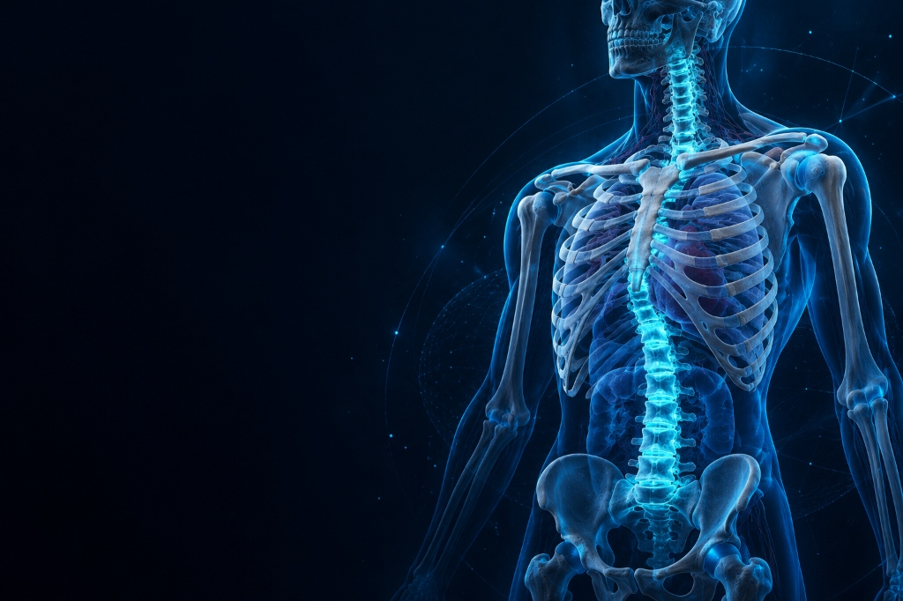
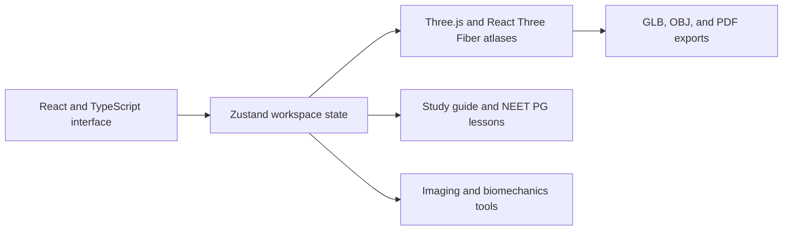

# BoneVista

**An interactive 3D anatomy and biomechanics workspace for the browser.** Explore segmented anatomy, study how body systems work, and connect reference models with learning and imaging tools.

<p align="center">
  
</p>

BoneVista brings anatomy atlases, physiology lessons, guided study, radiograph viewing, and an educational biomechanics model into one React application. The atlas is for learning and reference; the radiograph viewer does not interpret images or diagnose conditions.

## Features

- **Segmented skeletal atlas:** Browse and select structures from a 335+ structure reference skeleton, inspect labels, isolate anatomy, and use standard camera views.
- **Muscle explorer:** Switch between skeletal, superficial, deep, and combined views of the segmented muscle atlas.
- **Brain and nervous-system atlases:** Explore brain structures and peripheral nerve pathways with searchable structure lists and visibility controls.
- **Spine explorer:** Study 26 individually represented vertebral and curvature segments, organized by region.
- **Educational stress analysis:** Adjust loading inputs in a one-dimensional axial-bar finite-element teaching model and view its illustrative stress mapping on the anatomy model. It is not a patient-specific or geometry-solving simulation.
- **Radiograph workspace:** View AP and lateral images, upload supported image files, adjust zoom, rotation, brightness, and contrast, and associate an image with a bone in the existing skeleton. The selected reference bone can then be highlighted in the atlas. No 3D anatomy is generated from the image.
- **NEET PG physiology lessons:** Six animated lessons cover neural conduction, action potentials, synapses, reflexes, muscle contraction, and cardiac conduction. Each includes high-yield notes and a practice question.
- **Study guide:** Follow seven short learning paths and use quick-recall questions to review key anatomy topics.
- **Exports and credits:** The 3D workspace provides GLB, OBJ, and PDF export tools. The Resources & Credits module and repository notices document data provenance and licenses.

## Getting started

### Requirements

- Node.js **20.19+** or **22.12+**
- npm
- A modern browser with WebGL support for the 3D workspace

### Run locally

```bash
git clone https://github.com/spixcy/BoneVista.git
cd BoneVista
npm install
npm run dev
```

Open the local address printed by Vite (usually `http://localhost:5173`).

### Production build and browser tests

```bash
npm run build
npm run test:e2e
```

`npm run build` runs the TypeScript project build and creates the production app in `dist/`. End-to-end tests use Playwright; install the browser required by your Playwright setup if it is not already available.

## How it is organized



The main application is a client-rendered React single-page app. Three.js and React Three Fiber render the 3D models; Zustand coordinates workspace selections and controls. Anatomy assets and their manifests are served from `public/`.

The X-ray reconstruction service in `xray-reconstruction-service/` is a separate FastAPI prototype. Its default inference adapter reports that no model is available, and the current web app does not use it to reconstruct images. Follow that directory's README only if you want to run or develop the standalone service.

## Repository map

```text
src/
  components/       Workspace modules and shared interface components
  data/             Anatomy, spine, and resource metadata
  pages/            Bone explorer and NEET PG lesson pages
  store/            Shared application state
public/
  anatomy/          Segmented skeletal atlas and notices
  muscle-atlas/     Muscle atlas assets and attribution
  neuro/            Brain and peripheral nerve assets and attribution
  branding/         Landing page and workspace illustrations
  test-images/      Optional teaching radiograph samples
tests/              Playwright end-to-end tests
xray-reconstruction-service/
                    Standalone, unconfigured FastAPI prototype
```

## Privacy and image handling

Images uploaded to the radiograph viewer are held in browser memory for the current session; the viewer does not send them to an inference service. Choosing the optional bundled teaching samples fetches those sample files from the app's local server. The application also loads its static anatomy assets and may request externally hosted fonts, depending on network access. Workspace preferences may be stored in browser storage.

## Attribution and licensing

BoneVista's application code is MIT-licensed. The anatomy models and derived data have their own attribution and share-alike terms, which differ by dataset. Review [`LICENSES.md`](LICENSES.md), [`THIRD-PARTY-NOTICES.md`](THIRD-PARTY-NOTICES.md), and the notices alongside the anatomy assets before redistributing them. These files, rather than a single repository-wide badge, are the source of truth for asset licensing.

## Educational use

BoneVista is an educational anatomy and biomechanics project. It is not a medical device and does not provide diagnosis, treatment recommendations, clinical measurements, or patient-specific reconstruction. Do not use its illustrative stress model or reference anatomy for clinical decisions.

## Contributing

Issues and pull requests are welcome. For changes to anatomy assets, include the relevant source, license, and attribution information. Please describe the affected workspace module and how you verified the change.
